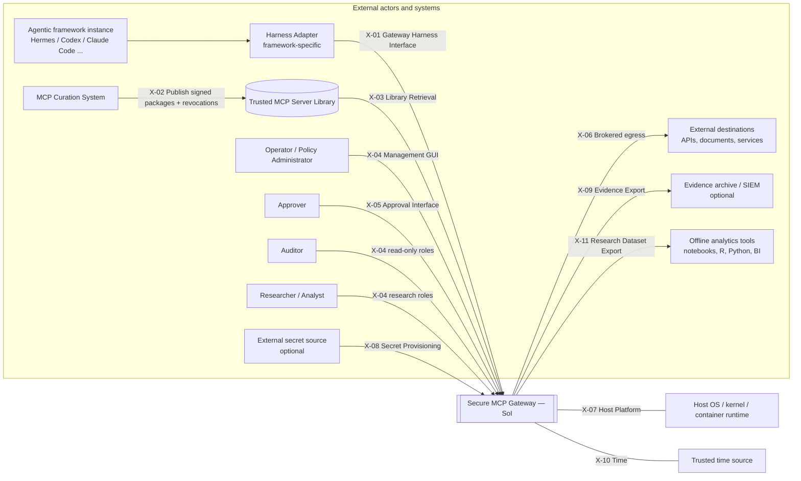
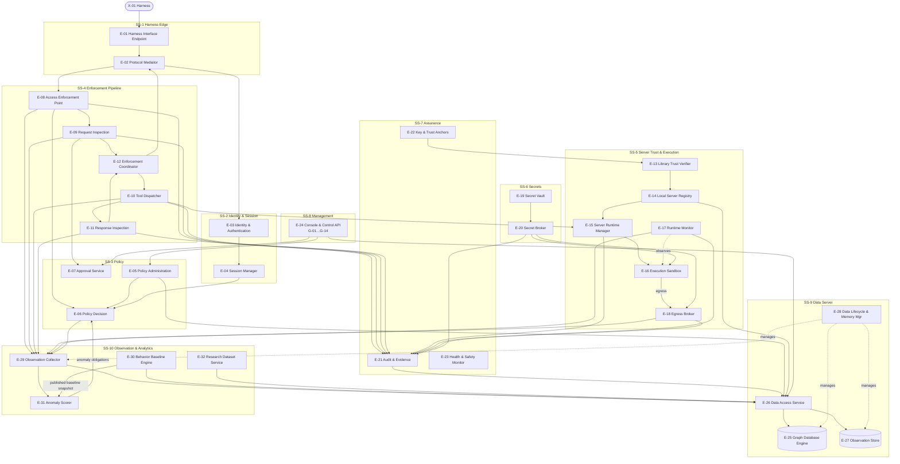
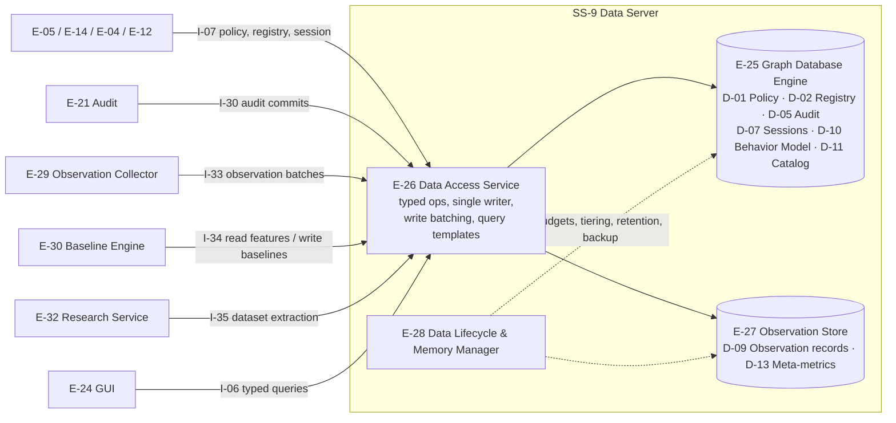
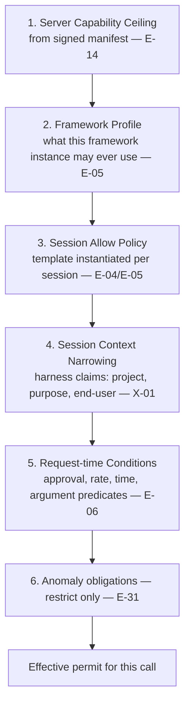
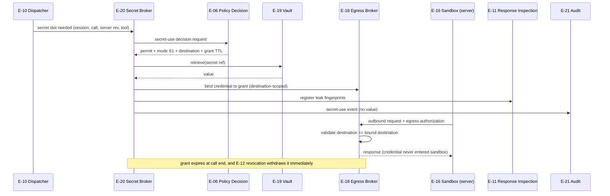
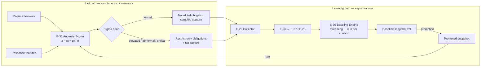
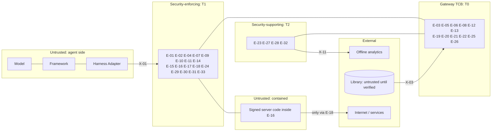
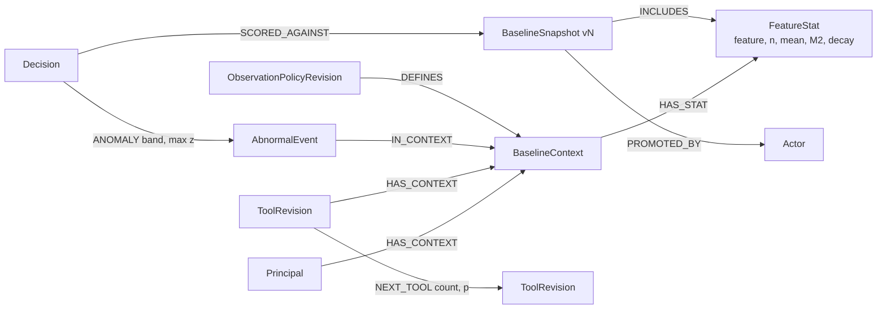
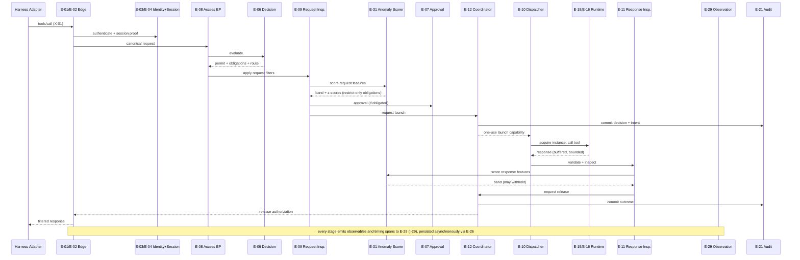

# Secure MCP Gateway — Architecture V2 (Logical Decomposition)

**Document:** `ArchitectureV2.md`
**Revision:** V2.2 draft (proposed)
**Date:** 2026-10-16 (America/New_York)
**Owner:** netrisk
**Inputs:** `architecture.md` rev 2.0 (problem-space analysis), `MCP_Gateway_Security_SRS.md` V1 (security-control set; renamed from `MCP_Gateway_SRS.md`), `Secure-MCP-Gateway-Research-Brief.md`
**Intended consumer:** SRS V2. This document gives the elements, functions and interfaces that SRS V2 allocates requirements to.
**Status:** Proposed architecture. Nothing in this document has been implemented or verified.

---

## 1. Purpose and how to use this document

`architecture.md` rev 2.0 is an accurate assessment of the problem space: threats, Neo4j CE limits, MCP protocol pitfalls, race conditions, egress hazards, audit consistency and the engineering-server catalog. It is organized around a technology selection, not around allocatable components. `MCP_Gateway_Security_SRS.md` V1 is a catalog of **security controls** written as MUST statements. It is not yet a set of SHALL requirements allocated to parts of a system.

This document closes that gap. It:

1. Decomposes the Secure MCP Gateway (the **System of Interest, SoI**) into **subsystems → elements** with stable IDs.
2. Defines **functions** with stable IDs and allocates each function to exactly one owning element.
3. Defines **external and internal interfaces** with stable IDs, the data that crosses them and their trust direction.
4. Defines the **Data Server** (graph database plus companion stores) and the data each store holds.
5. Defines the **observation, behavior-characterization and research-capture** capability: policy-directed capture of a large parameter set, statistical baselines of normal behavior, standard-deviation anomaly scoring, and offline research export.
6. Gives an **allocation matrix** that maps each V1 control root onto V2 elements, and recommends a structure for SRS V2.

The architecture is **logical** (technology-neutral). Section 15 records candidate physical realizations as options, not baseline decisions.

### 1.1 Recommended SRS V2 pattern

- **System level (SoI):** a small number of **MUST** security-outcome roots (e.g., *The Gateway MUST restrict tool execution to authority granted by the session's Allow policy.*).
- **Function level:** **SHALL** requirements on each function `F-xx` (what and how well), derived from the MUST roots or from functional needs such as research capture.
- **Element level:** **SHALL** requirements allocated to element `E-xx` for each function the element owns, plus element-specific constraints (performance, memory, isolation, failure behavior).
- **Interface level:** **SHALL** requirements on each interface `I-xx`/`X-xx` (protocol, authentication, data items, error behavior), ideally captured in an ICD per external interface.
- **GUI level:** **SHALL** requirements on each GUI view module `G-xx` (Section 4, E-24).

Every leaf SHALL should name its element in its subject (e.g., *"The Anomaly Scorer (E-31) SHALL …"*). That makes allocation explicit and keeps orphan/barren analysis mechanical.

---

## 2. Operating concept

### 2.1 Vision (owner statement, restated)

1. **Curated, signed servers only.** MCP servers are curated outside the Gateway. The curation system delivers each one as a **digitally signed package with metadata** into a **Trusted MCP Server Library**. The Gateway hosts and runs only servers whose signature and metadata it has verified.
2. **Authenticated agentic frameworks.** Agentic frameworks (Hermes, Codex CLI, Claude Code and others) reach the Gateway through a **harness-specific interface**. The Gateway authenticates the framework instance and establishes a **session**.
3. **Tailored Allow policy per session.** Each session runs under an **Allow policy** that is tailored to that session. Everything not explicitly allowed is denied.
4. **Controls at three points.** Security controls apply at **access time** (before dispatch), at **run time** (while the server executes) and on the **tool-call response** (before content is released to the agent).
5. **Managed secrets.** The Gateway holds the secrets that servers need. It assures that a secret is used only when authorized and only in the way a defined **Secret Use Policy** permits. Secrets are never disclosed to the agent or the harness.
6. **Audit per policy, normal and abnormal.** Audit is policy-directed. The policy specifies what to capture about both **normal** and **abnormal** behavior. From captured metrics the Gateway **learns to characterize** tool-call and tool-response patterns and classifies new activity as normal or abnormal by its **distance from the mean in standard deviations**.
7. **Research instrument.** By tuning policy through a GUI, an operator can record tool-use data for **offline analysis**. A user-friendly GUI selects the parameters to record from a catalog that is as broad as practical.
8. **High-performance graph Data Server.** A graph database hosts the policy, the server registry, audit relationships and the behavior model. Companion components handle high-volume metrics where needed. The Data Server manages its memory.
9. **Self-measurement.** The Gateway captures **meta-metrics** about itself: throughput, per-stage timing and the time cost of applying each policy element, filter and capture step.
10. **One control GUI** controls the Gateway, manages policy and tunes audits and capture.

### 2.2 Scope assumptions

| ID | Assumption | Consequence for the architecture |
|---|---|---|
| A-1 | An external **MCP Curation System** performs source review, build, testing, risk classification and signing. It publishes signed packages, metadata and a revocation feed into the Trusted MCP Server Library. | The V1 in-gateway quarantine/source-viewer/admission workflow (V1 §3, rev 2.0 §7.1) moves **outside** the SoI. The Gateway **verifies** curation evidence; it does not perform curation. |
| A-2 | Each agentic framework connects through a **Harness Adapter** that conforms to the Gateway Harness Interface (X-01). The Gateway release ships reference adapters (E-33) that use the hooks shipping frameworks already provide: OAuth 2.1 sign-in, a header-helper command, or a stdio `command`. | The Gateway exposes one uniform interface. Framework-specific translation lives in the adapter. The adapter runs on the harness host and is **untrusted** for authorization decisions, even though the release ships it. |
| A-3 | Servers run on the same host as the Gateway (local hosting), or on hosts the Gateway's Server Runtime Manager controls directly. | Run-time controls (sandboxing, egress, resource limits) are Gateway functions, not delegated to third parties. |
| A-4 | The host kernel, the Gateway's own binaries and the trust-anchor store are trusted. | These form the trusted computing base (TCB, Section 12). A hostile host administrator is out of scope, as in V1. |
| A-5 | The model behind the agent is untrusted. Its tool requests, arguments and any text it relays are attacker-influenceable. | All authorization derives from authenticated identity plus policy, never from model output. |
| A-6 | Behavior baselines are learned from observed traffic, and an attacker who controls traffic can try to shift them (**baseline poisoning**). | Learning is asynchronous, uses versioned baseline snapshots, excludes flagged samples and requires a promotion step before a baseline affects enforcement (Section 9.4). |
| A-7 | Anomaly classification can **restrict** but never **grant**. | A "normal" score never substitutes for a permit. An "abnormal" score can only add obligations (alert, more capture, approval, withhold, suspend). This preserves V1 1.12 (no semantic authorization). |

### 2.3 System context

---

## 3. Decomposition overview

The SoI decomposes into **ten subsystems** and **thirty-three elements**. Element IDs are stable. Later revisions retire IDs instead of reusing them.

| Subsystem | Elements |
|---|---|
| **SS-1 Harness Edge** | E-01 Harness Interface Endpoint · E-02 Protocol Mediator · E-33 Harness Adapter Kit |
| **SS-2 Identity & Session** | E-03 Identity & Authentication Service · E-04 Session Manager |
| **SS-3 Policy** | E-05 Policy Administration Service · E-06 Policy Decision Service · E-07 Approval Service |
| **SS-4 Enforcement Pipeline** | E-08 Access Enforcement Point · E-09 Request Inspection Pipeline · E-10 Tool Dispatcher · E-11 Response Inspection Pipeline · E-12 Enforcement Coordinator |
| **SS-5 Server Trust & Execution** | E-13 Library Trust Verifier · E-14 Local Server Registry · E-15 Server Runtime Manager · E-16 Execution Sandbox · E-17 Runtime Monitor · E-18 Egress Broker |
| **SS-6 Secrets** | E-19 Secret Vault · E-20 Secret Broker |
| **SS-7 Assurance** | E-21 Audit & Evidence Service · E-22 Key & Trust Anchor Manager · E-23 Health & Safety Monitor |
| **SS-8 Management** | E-24 Management Console & Control API (with GUI view modules G-01…G-14) |
| **SS-9 Data Server** | E-25 Graph Database Engine · E-26 Data Access Service · E-27 Observation Store · E-28 Data Lifecycle & Memory Manager |
| **SS-10 Observation & Analytics** | E-29 Observation Collector · E-30 Behavior Baseline Engine · E-31 Anomaly Scorer · E-32 Research Dataset Service |

---

## 4. Element specifications

Each element entry gives: **purpose**, **owned functions** (Section 5), **interfaces** (Section 6), **owned data**, **trust level**, and **requirement allocation targets**. The targets are the kinds of SHALL requirements SRS V2 should allocate to that element.

Trust levels: **T0** = TCB, compromise defeats the security guarantee; **T1** = security-enforcing, compromise defeats specific controls; **T2** = security-supporting; **U** = untrusted, contained.

### SS-1 Harness Edge

#### E-01 Harness Interface Endpoint — T1
- **Purpose:** The only network/IPC listener that harness adapters can reach. Terminates the transport (TLS or local socket), applies connection-level limits, and hands authenticated frames to E-02.
- **Functions:** F-01 Terminate harness transport.
- **Interfaces:** X-01 (provider), I-01, I-29.
- **Owned data:** listener configuration, transport certificates (keys held by E-22).
- **Allocation targets:** listener binding (interface/address restrictions); TLS profile and certificate name validation; Origin/Host validation (V1 2.9); connection, request-size and rate bounds before parsing (V1 7.11); rejection behavior and error schema; emission of transport timing and connection observables.

#### E-02 Protocol Mediator — T1
- **Purpose:** Parses and validates MCP JSON-RPC traffic against qualified protocol profiles, normalizes it into a canonical internal request, and serializes released responses back to the harness. Advertises only the MCP features the Gateway has qualified.
- **Functions:** F-02 Validate and normalize MCP messages; F-03 Negotiate protocol profile; F-22 Serialize released response.
- **Interfaces:** I-01, I-02, I-03, I-16, I-29.
- **Owned data:** protocol profile definitions (versions, feature allowlist).
- **Allocation targets:** supported MCP versions; header/body agreement (V1 5.2); no downgrade (V1 5.3); unsupported-feature rejection (resources, sampling, elicitation and similar until qualified); canonicalization rules; malformed-message handling.

#### E-33 Harness Adapter Kit — T1 (runs on the harness host; untrusted for authorization)
- **Purpose:** Reference adapters shipped with the Gateway release so that shipping frameworks reach X-01 without framework-specific code inside the Gateway. `smcp-session` obtains and refreshes a session through the Gateway's OAuth token endpoint or session API and prints the headers a framework's header-helper hook expects. `smcp-stdio` is launched by a framework as a stdio MCP server and forwards newline-delimited JSON-RPC to the Gateway over X-01, adding only transport and authentication. Adapters hold a principal credential and are security-enforcing for credential custody. The Gateway never trusts them for authorization (A-2).
- **Functions:** F-94 Obtain and refresh harness session; F-95 Bridge stdio to the harness interface.
- **Interfaces:** X-01 (consumer), X-12 (provider).
- **Owned data:** principal credential and refresh token on the harness host (file, mode 0600); no policy, no audit, no tool results.
- **Allocation targets:** credential file location and mode; refresh before expiry; pass-through of both protocol eras unchanged; exit on session revocation; no caching of tool results; conformance to the framework hooks named in the X-12 ICD (Claude Code `headersHelper`, Codex `http_headers_helper`, stdio `command` for all supported frameworks).

### SS-2 Identity & Session

#### E-03 Identity & Authentication Service — T0
- **Purpose:** Authenticates the **framework instance** on every request using credentials issued to that instance. Derives the **Principal** (framework identity) from verified credentials only and never from self-asserted `clientInfo` or model text. Optionally accepts a harness-asserted **end-user attribute** that can only narrow policy.
- **Functions:** F-04 Authenticate framework instance; F-05 Verify session proof.
- **Interfaces:** I-02, I-04, I-17 (to E-22).
- **Owned data:** principal registry and credential verifiers (persisted in E-25 via E-26), revocation epochs.
- **Allocation targets:** credential type (OAuth 2.1 client registration bound to a principal in the baseline; mTLS client certificate or UDS peer credential under profiles); per-request authentication (V1 2.1); distinct credentials per framework instance (V1 2.2); revocation propagation deadline (V1 2.4); separation of client and backend credentials (V1 2.10); failed-authentication evidence.

#### E-04 Session Manager — T1
- **Purpose:** Creates, binds, refreshes and terminates **Gateway sessions**. A session binds {principal, harness type, declared purpose/project, optional end-user attribute, selected Allow policy revision, selected Observation Policy, issued session key, lifetime}. Gateway sessions are a Gateway concept. They are independent of MCP transport sessions, which may be stateless.
- **Functions:** F-06 Establish session; F-07 Bind Allow policy to session; F-08 Maintain session state and expiry; F-09 Terminate or revoke session.
- **Interfaces:** I-04, I-05, I-18, I-29.
- **Owned data:** D-07 Session Table.
- **Allocation targets:** session establishment preconditions; session token binding to framework credential (no bearer replay); maximum lifetime and idle timeout; policy-revision pinning and re-evaluation on revision change; session revocation latency; concurrent-session limits per principal; owner-binding of server-side state handles (V1 3.14); binding of the session to a baseline context key (Section 9.3).

### SS-3 Policy

#### E-05 Policy Administration Service — T0
- **Purpose:** Authoring, validation, simulation and atomic publication of immutable policy revisions: **Framework Profiles**, **Session Allow Policy templates**, **Secret Use Policies**, **Response Policies**, **Audit Profiles**, **Observation Policies** and **Anomaly Response Policies** (Sections 7 and 9).
- **Functions:** F-10 Validate policy revision; F-11 Simulate policy; F-12 Publish/activate policy revision; F-66 Estimate observation cost.
- **Interfaces:** I-06 (from E-24), I-07 (to E-26).
- **Owned data:** D-01 Policy Graph (hosted in E-25).
- **Allocation targets:** schema/type validation; rejection of ambiguous or overlapping grants (V1 1.9); capability-ceiling check against server manifests (Section 7.3); immutability of published revisions (V1 1.14); atomic activation (V1 1.15); publication ordering under the coordinator (V1 1.16); simulation fixtures before publication; Observation Policy validation against the Parameter Catalog (D-11) and sensitivity rules; storage and overhead estimates shown before publication.

#### E-06 Policy Decision Service — T0
- **Purpose:** Deterministic evaluation of a canonical request against the session's effective policy. Returns *permit/deny*, decisive rules, obligations (filters, approval, audit profile, observation profile, secret grants, limits) and the single selected route. Merges **anomaly obligations** from E-31, which can only restrict.
- **Functions:** F-13 Evaluate access decision; F-14 Compute effective obligations; F-15 Evaluate secret-use decision; F-16 Explain decision.
- **Interfaces:** I-05, I-08, I-09, I-14, I-31, I-29.
- **Owned data:** in-memory compiled policy snapshot (source D-01).
- **Allocation targets:** default deny (V1 1.3); deny precedence (V1 1.4); typed predicates only (V1 1.7); argument scoping (V1 1.8); obligation combination (V1 1.10); deterministic routing (V1 1.11); no semantic/LLM authorization (V1 1.12); anomaly results restrict-only (A-7); recording of the baseline snapshot ID used in each decision; bounded evaluation work and timeouts (V1 1.20); fail closed on store outage (V1 1.2); explanation output (V1 1.19); per-rule evaluation timing emitted.

#### E-07 Approval Service — T1
- **Purpose:** Human-in-the-loop approval for actions whose policy obligation requires it, including approvals triggered by anomaly obligations. Approvals are **one-use** and bound to {session, principal, exact server/tool revision, final argument digest, policy revision, expiry}. The approval channel is out-of-band from the harness, so a model cannot approve its own request.
- **Functions:** F-17 Request approval; F-18 Record and consume approval.
- **Interfaces:** X-05, I-10, I-18.
- **Owned data:** approval records (D-01).
- **Allocation targets:** approval binding fields (V1 1.18); expiry; one-use consumption; re-approval on argument change after redaction; approver authentication separate from harness credentials; denial on timeout; display of anomaly evidence (feature, z-score, baseline) to the approver.

### SS-4 Enforcement Pipeline

#### E-08 Access Enforcement Point — T0
- **Purpose:** The **access-time** policy enforcement point. Filters the tool catalog the session can discover, and admits or rejects each tool call based on E-06 decisions. Ensures that no request reaches dispatch without a permit decision.
- **Functions:** F-19 Present session-scoped catalog; F-20 Enforce access decision.
- **Interfaces:** I-03, I-08, I-18, I-29.
- **Owned data:** per-session catalog cache keyed to policy revision.
- **Allocation targets:** catalog filtering by session policy (unlisted tools are invisible and uncallable); new tools denied until granted (V1 3.10); no administrative tools exposed (V1 3.12); cache scoping to principal + revision; dispatch impossible without a recorded permit.

#### E-09 Request Inspection Pipeline — T1
- **Purpose:** Applies the required **request-side filters** named by the decision obligations to canonical arguments before dispatch: schema validation, path/URL canonicalization and scope checks, size limits, injection and secret-exfiltration detectors, and redaction. Requests re-authorization when a filter changes action-defining arguments. Invokes **request-time anomaly scoring** (E-31) when the Observation Policy requires it.
- **Functions:** F-21 Inspect and transform request.
- **Interfaces:** I-09, I-10, I-11, I-18, I-29, I-31.
- **Owned data:** filter profile implementations (versioned).
- **Allocation targets:** ordered required filters; block on filter failure; argument schema validation; canonical path and URL checks; re-authorization after transformation (rev 2.0 §4.2 step 7); bounded filter time and memory; per-filter timing emitted.

#### E-10 Tool Dispatcher — T1
- **Purpose:** Routes an authorized request to exactly one admitted server instance over the selected route. Correlates the response and enforces call timeouts and cancellation.
- **Functions:** F-23 Dispatch tool call; F-24 Correlate and collect response; F-25 Cancel in-flight call.
- **Interfaces:** I-11, I-12, I-13, I-29.
- **Owned data:** in-flight invocation table.
- **Allocation targets:** single-route dispatch; launch-capability check from E-12; per-call timeout; cancellation propagation (V1 7.12); response size bound and buffering before release; correlation ID integrity; indeterminate-outcome marking (V1 7.2); emission of queue wait, server execution time and response size.

#### E-11 Response Inspection Pipeline — T1
- **Purpose:** The **response-time** enforcement point. Validates the response envelope and output schema, then applies response filters: secret-leak detection (using fingerprints from E-20), PII/data-class redaction, prompt-injection and active-content markers, Unicode-control checks and media/binary blocking. Invokes **response-time anomaly scoring** (E-31). Labels provenance and decides **release / redact / withhold**.
- **Functions:** F-26 Validate response conformance; F-27 Inspect and transform response; F-28 Label provenance.
- **Interfaces:** I-13, I-14, I-15, I-18, I-29, I-31.
- **Owned data:** response filter profiles (versioned).
- **Allocation targets:** response conformance (V1 5.20); complete-buffer inspection before release; secret-fingerprint match causes withhold (Section 8.5); unsupported content blocked; required-filter failure blocks; abnormal-response obligations applied before release; provenance labels survive transformation; bounded inspection cost; per-filter timing emitted.

#### E-12 Enforcement Coordinator — T0
- **Purpose:** The serialization point (rev 2.0 §4.3). It owns the **dispatch barrier** and the **release barrier**, policy activation ordering, revocation and the emergency stop. Under the barrier it rechecks policy revision, session validity and epochs, records intent, then hands out a one-use launch capability or release authorization.
- **Functions:** F-29 Authorize launch under barrier; F-30 Authorize release under barrier; F-31 Execute emergency stop; F-32 Apply revocation.
- **Interfaces:** I-11, I-15, I-16, I-19, I-20, I-29.
- **Owned data:** policy-control record (active revision, stop/revocation epochs), persisted in D-01.
- **Allocation targets:** pre-dispatch and pre-release rechecks (V1 1.17); intent committed before launch (V1 6.2); outcome committed before release (V1 6.3); emergency stop latency (V1 7.6); stop dispatch when audit export lags (V1 6.11) or mandatory audit capacity is exhausted (V1 7.10); invalidation of outstanding capabilities at startup; barrier hold-time emitted as a meta-metric.

### SS-5 Server Trust & Execution

#### E-13 Library Trust Verifier — T0
- **Purpose:** Imports server packages from the Trusted MCP Server Library. It verifies the **curation signature** against trust anchors from E-22, verifies the artifact digests, validates the **metadata manifest** schema, and checks the revocation feed. Packages that pass are installed into E-14. Every server start is re-verified.
- **Functions:** F-33 Verify package signature and integrity; F-34 Validate server manifest; F-35 Process revocation feed.
- **Interfaces:** X-03, I-17, I-21, I-18.
- **Owned data:** import receipts (D-02).
- **Allocation targets:** accepted signature algorithms and key sizes; trust-anchor scoping (which signer may sign which risk class); manifest schema conformance; rejection of unsigned, expired, revoked or digest-mismatched packages; revocation check freshness bound; re-verification at instantiation; downgrade/rollback protection (monotonic version or explicit operator override).

#### E-14 Local Server Registry — T1
- **Purpose:** The Gateway's inventory of verified server revisions and their manifests: tools, schemas, declared capabilities, egress needs, secret requirements, risk class, curation attestations, **declared behavior baseline hints** and expiry. It is the source of the **capability ceiling** that policy cannot exceed.
- **Functions:** F-36 Maintain verified server inventory; F-37 Detect drift and expiry.
- **Interfaces:** I-21, I-22, I-07.
- **Owned data:** D-02 Server Registry (hosted in E-25), D-03 Artifact Cache.
- **Allocation targets:** immutable revision records; tool schema and description digests (V1 3.7); suspension on drift (V1 3.8); expiry and re-curation date; activation-state control by operator (verified ≠ enabled); baseline reset or carry-forward rule when a server revision changes.

#### E-15 Server Runtime Manager — T1
- **Purpose:** Instantiates, supervises and tears down server instances from verified artifacts only, under the sandbox profile derived from the manifest plus policy. Launches with exact executable and argument vectors, never a shell. Chooses instance scope (per-session, per-principal or shared, as the manifest and policy permit).
- **Functions:** F-38 Instantiate server instance; F-39 Supervise lifecycle; F-40 Tear down and sanitize.
- **Interfaces:** I-12, I-22, I-23, X-07, I-29.
- **Owned data:** instance table.
- **Allocation targets:** launch only from verified digest (V1 3.6); safe process launch (V1 4.8); instance isolation scope per risk class; separate OS identity per trust scope (V1 4.1); restart and crash policy; teardown removes scratch and per-call secrets; cold-start time and instance resource use emitted.

#### E-16 Execution Sandbox — T1 (contained workload is **U**)
- **Purpose:** The run-time containment boundary around each server instance: filesystem view, process, network namespace, resource limits and syscall profile. The server code inside is untrusted even when signed.
- **Functions:** F-41 Contain server execution.
- **Interfaces:** I-23, I-24, I-25, X-07.
- **Owned data:** sandbox profiles.
- **Allocation targets:** filesystem authority limited to manifest-declared and policy-granted mounts (V1 4.6); no direct network, egress only through E-18 (V1 4.5); CPU, memory, file-descriptor and wall-time limits; host-management exclusion (V1 4.7); no access to Gateway stores, the Data Server or credentials (V1 4.2); syscall/LSM profile.

#### E-17 Runtime Monitor — T1
- **Purpose:** The **run-time** detection element. Observes sandbox behavior (process spawns, file access, egress attempts, resource consumption, unexpected tool-list changes). Applies **rule-based** checks against the manifest's declared behavior and feeds raw runtime observables to E-29 for **statistical** characterization. Raises events and can request instance termination or session suspension.
- **Functions:** F-42 Observe runtime behavior; F-43 Detect declared-behavior deviation; F-44 Trigger containment response.
- **Interfaces:** I-24, I-19, I-18, I-29.
- **Owned data:** declared behavior rules from manifests.
- **Allocation targets:** observable event set; deviation rules; response actions and latency (kill instance, suspend server revision, alert); tool-list change at runtime causes suspension (V1 3.8); runtime observables supplied to E-29 at the granularity the Observation Policy selects.

#### E-18 Egress Broker — T1
- **Purpose:** The only path from sandboxes to external networks. Each outbound operation needs a one-use authorization derived from the decision obligations. The broker canonicalizes and validates the destination, resolves DNS under its own control, blocks private and metadata ranges, validates TLS, and, for **proxy-injected secrets**, attaches the credential itself so that the server never holds it.
- **Functions:** F-45 Authorize and mediate egress; F-46 Inject credential at egress.
- **Interfaces:** I-25, I-26, X-06, I-18, I-29.
- **Owned data:** egress allowlists (from D-01), DNS resolution records.
- **Allocation targets:** default-deny egress; destination canonicalization (rev 2.0 §6); DNS rebinding protection; redirect re-authorization; private/reserved range denial; method restrictions (V1 5.19); TLS validation; credential attachment only for the secret's bound destination (Section 8); per-operation audit; egress volume, destination and timing observables.

### SS-6 Secrets

#### E-19 Secret Vault — T0
- **Purpose:** Encrypted storage of secret material, with references, versions, rotation metadata and owner binding. It never releases plaintext except to E-20. **Deliberately separate from the Data Server** so a Data Server compromise does not expose secret values.
- **Functions:** F-47 Store and protect secrets; F-48 Rotate and retire secrets.
- **Interfaces:** X-08, I-27, I-06 (metadata only, from E-24).
- **Owned data:** D-04 Secret Vault.
- **Allocation targets:** encryption at rest and key custody via E-22 (V1 2.13); secrets write-only from the console (values never readable back); rotation support; zeroization on retirement; access only by E-20's identity.

#### E-20 Secret Broker — T0
- **Purpose:** Enforces the **Secret Use Policy** at the moment a secret is needed. It requests a secret-use decision from E-06, then delivers the secret in the least-exposing mode the server supports (Section 8.2). It registers non-reversible **fingerprints** with E-11 so leaks in responses are detected, and records every use.
- **Functions:** F-49 Authorize secret use; F-50 Deliver secret; F-51 Register leak fingerprints; F-52 Revoke secret delivery.
- **Interfaces:** I-27, I-28, I-26, I-14, I-18.
- **Owned data:** active grant table (grant ID, secret ref, instance, call, expiry).
- **Allocation targets:** no secret delivered without a permit decision; delivery-mode preference order; grant lifetime bound to the call or instance; zero secrets in harness-bound traffic; zero secret values in observation, audit or research data (V1 6.7); minimal backend environment (V1 2.14); revocation on session end or emergency stop.

### SS-7 Assurance

#### E-21 Audit & Evidence Service — T0
- **Purpose:** The **security-evidence** path. Collects mandatory security events from all elements, links them to decisions, policy revisions, server revisions and sessions, persists them to the Data Server via E-26, and produces a signed, chained evidence journal that is independent of the Data Server. It is distinct from E-29: E-21 carries the non-disableable **mandatory floor**, while E-29 carries policy-tunable observation and research data.
- **Functions:** F-53 Record security event; F-54 Link evidence; F-55 Produce tamper-evident journal; F-56 Enforce retention and purge; F-57 Serve audit queries.
- **Interfaces:** I-18 (sink), I-30, X-09, I-06.
- **Owned data:** D-05 Audit Graph (hosted in E-25), D-06 Evidence Journal, optional encrypted payload blobs.
- **Allocation targets:** mandatory metadata floor (V1 6.1); historical links (V1 6.4); event origin vs target (V1 6.5); payload policy and encryption (V1 6.6, 6.8); secret removal (V1 6.7); export idempotence and lag bound (V1 6.10, 6.11); independent tamper evidence (V1 6.12); retention and purge (V1 6.9, 6.14, 6.15); mandatory-floor priority over observation traffic when resources are constrained.

#### E-22 Key & Trust Anchor Manager — T0
- **Purpose:** Custody of all Gateway cryptographic material: **curation trust anchors** (keys allowed to sign server packages), framework credential issuance and verification keys, transport certificates, the vault master key, the evidence-signing key, the Data Server credentials and the research pseudonymization key.
- **Functions:** F-58 Manage trust anchors; F-59 Issue and revoke framework credentials; F-60 Protect Gateway keys.
- **Interfaces:** I-17, I-06, X-07 (optional hardware key store/TPM).
- **Owned data:** D-08 Trust Anchor & Key Store.
- **Allocation targets:** trust-anchor enrollment requiring an operator ceremony; anchor scope and expiry; key separation by purpose; hardware-backed storage where available; credential lifetime; key rotation and compromise recovery.

#### E-23 Health & Safety Monitor — T2
- **Purpose:** Monitors the dependencies whose failure makes enforcement unsafe (Data Server availability, audit export lag, mandatory-audit capacity, vault availability, clock sanity, trust-anchor validity, memory pressure reported by E-28) and drives the fail-closed state through E-12.
- **Functions:** F-61 Monitor enforcement health; F-62 Drive fail-closed state.
- **Interfaces:** I-19, I-06, I-32.
- **Owned data:** health state.
- **Allocation targets:** monitored conditions and thresholds (V1 Appendix A); fail-closed on each critical dependency; health status reporting; recovery preconditions (V1 7.8, 7.9); distinction between degrade-observation (non-critical) and fail-closed (critical) conditions.

### SS-8 Management

#### E-24 Management Console & Control API — T1
- **Purpose:** The single GUI and control API for **controlling the Gateway, managing policy, and tuning audits, observation and research capture**. Serves operator, policy-author, approver, auditor and researcher roles, and authenticates human roles separately from framework principals. All mutations go through typed service APIs (E-05, E-07, E-19, E-22, E-28, E-32); E-24 never holds a raw database credential or exposes a query console.
- **Functions:** F-63 Authenticate administrative user; F-64 Enforce administrative roles; F-65 Present management views; F-67 Provide parameter-selection workbench; F-68 Present behavior analytics; F-69 Present performance and resource views.
- **Interfaces:** X-04, X-05, I-06.
- **Owned data:** admin accounts and verifiers; GUI presets (D-11).
- **Allocation targets:** admin identity and session protection (V1 2.5–2.7, 8.9); role separation (V1 8.10), including a **Researcher** role without policy-publication rights; no raw store access or query console; revision preconditions on mutation; inert rendering of server-supplied content (V1 6.17); local UI assets (V1 8.8); usability requirements for G-04 (Section 11).

**GUI view modules** (each is a separately allocatable sub-element of E-24):

| ID | View module | Primary users | Purpose |
|---|---|---|---|
| G-01 | Gateway Control | Operator | Start/stop, emergency stop, enforcement state, fail-closed causes |
| G-02 | Policy Studio | Policy author | Framework Profiles, Session Allow templates, Response and Secret Use Policies; simulate, diff and publish |
| G-03 | Audit Profile Tuning | Policy author, Auditor | Mandatory floor (read-only), optional capture, retention, alerting |
| G-04 | Observation & Parameter Workbench | Policy author, Researcher | Choose parameters from the Parameter Catalog, set scope, sampling, baseline contexts and thresholds; preview cost (Section 11) |
| G-05 | Behavior Analytics | Operator, Auditor, Researcher | Baselines per context, distributions, z-score timelines, abnormal-event drill-down, baseline promotion |
| G-06 | Anomaly Response Policy | Policy author | Map sigma bands to actions (log, alert, escalate capture, approve, withhold, suspend) |
| G-07 | Performance & Meta-metrics | Operator | Throughput, per-stage latency, policy cost in time, filter cost, capture overhead |
| G-08 | Data Server & Memory | Operator | Memory budgets, cache hit ratios, store sizes, tiering, retention, backup status |
| G-09 | Research Campaigns & Export | Researcher | Define capture campaigns, approve them, export datasets, view the data dictionary |
| G-10 | Servers & Library | Operator | Verified servers, manifests, enablement, drift, revocation |
| G-11 | Sessions & Principals | Operator | Framework credentials, active sessions, revocation |
| G-12 | Secrets | Operator | Secret metadata, Secret Use Policy bindings, rotation; values write-only |
| G-13 | Approvals | Approver | Pending approvals with bound request and anomaly evidence |
| G-14 | Audit Investigation | Auditor | Graph-led investigation of decisions, events, rules and servers (rev 2.0 §7.2) |

### SS-9 Data Server

The Data Server is a subsystem of several cooperating components. A **graph database** is the system of record for policy, registry, sessions, audit relationships and the behavior model, because those are highly connected and queried by relationship (who called what, under which rule, against which baseline). High-volume per-call observation records go to a companion **columnar Observation Store**. Graph engines are fast at traversals and point lookups but slow at wide aggregations over millions of rows, and the columnar store keeps those aggregations fast. **Speed on the enforcement hot path does not depend on a database round-trip.** Policy and baseline snapshots are compiled into memory (E-06, E-31), and the Data Server is written asynchronously except for the commits V1 requires before dispatch and release.

#### E-25 Graph Database Engine — T0
- **Purpose:** The graph database server. It hosts the policy graph, server registry, principals and sessions, the audit relationship graph, the **behavior model graph** (baseline contexts, baseline snapshots, tool-transition edges, abnormal-event links) and the Parameter Catalog.
- **Functions:** F-70 Persist and index graph data; F-71 Execute bounded graph queries and transactions.
- **Interfaces:** I-36 (from E-26 only), X-07.
- **Owned data:** D-01, D-02, D-05, D-07 (persisted part), D-10, D-11.
- **Allocation targets:** ACID transactions for decision/intent and outcome/release commits (V1 6.2, 6.3); uniqueness and integrity constraints, plus application validation where the engine lacks them (rev 2.0 §2); private listener reachable only by E-26 (V1 4.3); no telemetry egress; query latency targets (Section 14); memory configuration under E-28's control; offline or online backup per selected edition.

#### E-26 Data Access Service — T0
- **Purpose:** The only process holding Data Server credentials (rev 2.0 "graph service", generalized). Exposes typed operations to the other elements, maps them to fixed parameterized query templates, enforces per-caller authorization, acts as the single writer, batches high-volume writes and routes each write to the graph engine or the Observation Store.
- **Functions:** F-72 Authorize and execute typed data operations; F-73 Batch and route writes; F-74 Apply backpressure.
- **Interfaces:** I-07, I-30, I-33, I-34, I-35, I-06, I-36, I-37.
- **Owned data:** query template set (versioned).
- **Allocation targets:** fixed query templates only (V1 1.13); no caller-supplied query text, labels or procedure names; per-caller operation allowlist; idempotent writes with application-issued IDs (V1 7.1); priority ordering, so mandatory audit and policy writes outrank observation writes; backpressure signals to E-29 when write queues exceed thresholds; bounded query cost (V1 1.20); per-operation latency emitted.

#### E-27 Observation Store — T2
- **Purpose:** Columnar, append-oriented storage for high-volume per-call observation records (D-09) and Gateway meta-metrics (D-13). Supports fast aggregation for baseline training, the analytics GUI and research extraction.
- **Functions:** F-75 Store observation and meta-metric records; F-76 Serve aggregate queries.
- **Interfaces:** I-37 (from E-26 only).
- **Owned data:** D-09, D-13.
- **Allocation targets:** ingest rate (records/s) at the target load; aggregate-query latency; time-partitioned storage for retention and tiering; schema evolution as catalog parameters are added; no reachability from sandboxes or the harness.

#### E-28 Data Lifecycle & Memory Manager — T2
- **Purpose:** Manages memory and storage across the Data Server and the in-memory analytics caches. Sets and enforces memory budgets (graph engine heap and page cache, Observation Store buffers, E-29 capture queues, E-31 baseline cache). Manages hot/warm/cold tiering, retention execution, compaction, quota enforcement and backup scheduling.
- **Functions:** F-77 Allocate and enforce memory budgets; F-78 Manage storage tiers, retention and quotas; F-79 Schedule and verify backups.
- **Interfaces:** I-32 (to E-23), I-38 (to E-25, E-27, E-29, E-31), I-06.
- **Owned data:** memory and storage budget configuration; tiering state.
- **Allocation targets:** a host memory budget partitioned by component, with no component exceeding its allocation; graceful-degradation order under memory pressure: (1) reduce optional capture sampling, (2) drop optional payload capture, (3) shed research capture, (4) never drop the mandatory audit floor, and fail closed through E-23 if the floor cannot be written; cache hit-ratio reporting; tier migration rules; quota warning at 80% and stop thresholds (V1 7.10); backup and restore verification (V1 7.7, 7.8).

### SS-10 Observation & Analytics

#### E-29 Observation Collector — T1
- **Purpose:** Captures **observation records** for each tool call, response and session according to the active **Observation Policy**. Every instrumented element emits raw observables over I-29. E-29 selects the parameters the policy names, computes derived features (Section 10), applies sampling (e.g., sample normal calls, capture abnormal calls in full), strips secrets and applies sensitivity rules, and forwards batches to E-26. It also collects **meta-metrics** (per-stage timing spans, throughput, memory, queue depth).
- **Functions:** F-80 Collect raw observables; F-81 Extract features; F-82 Apply sampling, sensitivity and escalation rules; F-83 Collect meta-metrics.
- **Interfaces:** I-29 (sink from instrumented elements), I-31, I-33, I-38.
- **Owned data:** in-memory capture queues.
- **Allocation targets:** capture only parameters named by the active Observation Policy; feature-extraction correctness against the Parameter Catalog definitions; capture escalation on abnormal classification (from E-31) within the same call; secret removal before persistence (fingerprint check); bounded capture overhead (Section 14); a non-blocking hot path, so observation never delays release except where the policy requires synchronous scoring; queue bounds and drop accounting (drops are counted and reported, never silent).

#### E-30 Behavior Baseline Engine — T1
- **Purpose:** **Learns** the statistical characterization of normal behavior. For each **baseline context** (e.g., principal × tool × server revision, or session template × tool) and each numeric feature, it maintains streaming estimates of count, mean and variance (and optional robust statistics), plus sequence statistics such as tool-transition frequencies. It produces versioned **baseline snapshots** and manages their promotion to enforcement.
- **Functions:** F-84 Update baseline statistics; F-85 Build baseline snapshot; F-86 Promote or roll back baseline snapshot; F-87 Detect baseline drift.
- **Interfaces:** I-34, I-39 (to E-31), I-06.
- **Owned data:** D-10 Behavior Model (hosted in E-25).
- **Allocation targets:** statistical method per feature (Section 9.2); minimum sample count before a context is "characterized"; learning windows (sliding or decayed); exclusion of samples classified abnormal, denied or from flagged sessions (poisoning defense, A-6); snapshot immutability and versioning; promotion rule (operator approval, or automatic under policy-set limits on change magnitude); rollback; asynchronous operation, never on the hot path.

#### E-31 Anomaly Scorer — T1
- **Purpose:** **Classifies** activity as normal or abnormal at request time and response time. It holds the promoted baseline snapshot **in memory**, computes each selected feature's z-score `z = (x − μ) / σ` for the session's context, combines the scores per the Observation Policy, maps the result to a sigma band (normal / elevated / abnormal / critical), and returns the band and evidence to E-06/E-09/E-11 as restrict-only obligations.
- **Functions:** F-88 Score request features; F-89 Score response features; F-90 Classify and emit anomaly obligation.
- **Interfaces:** I-31, I-39, I-38.
- **Owned data:** in-memory baseline cache (snapshot ID recorded with every score).
- **Allocation targets:** scoring latency (p95 target, Section 14); determinism, where the same snapshot and features give the same band; defined handling of uncharacterized contexts (insufficient samples) per policy; σ floor to avoid divide-by-near-zero; recording of the scores, snapshot ID and contributing features with the decision; restrict-only effect (A-7).

#### E-32 Research Dataset Service — T2
- **Purpose:** Supports use of the Gateway as a **research instrument**. Manages **research capture campaigns**: a time-boxed, approved, scoped Observation Policy with an expanded parameter set. It extracts datasets from the Data Server, applies pseudonymization and sensitivity rules, generates a data dictionary from the Parameter Catalog, and exports in analysis-ready formats for offline tools.
- **Functions:** F-91 Manage research capture campaigns; F-92 Extract and pseudonymize datasets; F-93 Export datasets with data dictionary.
- **Interfaces:** I-35, X-11, I-06.
- **Owned data:** D-12 Research Datasets (export staging), campaign records (D-01).
- **Allocation targets:** campaign scope, expiry and approval (publication through E-05); pseudonymization with a keyed function (E-22 key) that is consistent within a dataset; export formats (e.g., Parquet, CSV, JSON Lines, GraphML); a data dictionary and provenance manifest (policy revision, baseline snapshot, catalog version, time range, filters) shipped with every dataset; export events audited; no secret values or raw S3 payloads exported without an explicit campaign grant.

---

## 5. Function catalog

Each function has exactly one **owning element**, which is the allocation target for its SHALL requirements. **Phase** gives the control point: **A** = access time, **R** = run time, **P** = response time, **M** = management, **S** = supporting/continuous, **O** = observation/analytics.

| ID | Function | Owner | Phase | Summary of required behavior |
|---|---|---|---|---|
| F-01 | Terminate harness transport | E-01 | A | Accept only qualified transports on bound listeners; enforce pre-parse bounds |
| F-02 | Validate and normalize MCP messages | E-02 | A | Reject malformed or unqualified messages; produce canonical request |
| F-03 | Negotiate protocol profile | E-02 | A | Select a qualified MCP profile; refuse downgrade |
| F-04 | Authenticate framework instance | E-03 | A | Verify the credential on every request; derive the principal |
| F-05 | Verify session proof | E-03 | A | Verify the session key proof-of-possession bound to the principal |
| F-06 | Establish session | E-04 | A | Create a session from principal + harness context |
| F-07 | Bind Allow policy to session | E-04 | A | Select the Allow template and Observation Policy; apply session parameters; pin revisions |
| F-08 | Maintain session state and expiry | E-04 | S | Track lifetime, idle timeout, owned state handles |
| F-09 | Terminate or revoke session | E-04 | S | End the session; revoke grants and instances it owns |
| F-10 | Validate policy revision | E-05 | M | Schema, type, ambiguity, ceiling, catalog and conflict checks |
| F-11 | Simulate policy | E-05 | M | Evaluate fixtures and show the effective-permission diff |
| F-12 | Publish/activate policy revision | E-05 | M | Atomic activation through E-12 |
| F-13 | Evaluate access decision | E-06 | A | Deterministic permit/deny with decisive rules |
| F-14 | Compute effective obligations | E-06 | A | Filters, approval, audit, observation, limits, route, egress, secret grants, anomaly obligations |
| F-15 | Evaluate secret-use decision | E-06 | A/R | Permit or deny a specific secret use against the Secret Use Policy |
| F-16 | Explain decision | E-06 | M | Produce a human-readable rule and anomaly trace for a decision |
| F-17 | Request approval | E-07 | A | Present the exact bound request (and anomaly evidence) to an authenticated approver |
| F-18 | Record and consume approval | E-07 | A | One-use, digest-bound, expiring approval |
| F-19 | Present session-scoped catalog | E-08 | A | List only tools the session's policy permits |
| F-20 | Enforce access decision | E-08 | A | Block every call that lacks a permit |
| F-21 | Inspect and transform request | E-09 | A | Apply required request filters; re-authorize on change |
| F-22 | Serialize released response | E-02 | P | Return only release-authorized content to the harness |
| F-23 | Dispatch tool call | E-10 | R | Send to the selected instance with a launch capability |
| F-24 | Correlate and collect response | E-10 | R | Bounded buffering; correlation integrity |
| F-25 | Cancel in-flight call | E-10 | R | Propagate cancellation on revoke, stop or timeout |
| F-26 | Validate response conformance | E-11 | P | Envelope, correlation and output schema checks |
| F-27 | Inspect and transform response | E-11 | P | Secret-leak, data-class, injection-marker and content-type filters |
| F-28 | Label provenance | E-11 | P | Mark content origin and transformations |
| F-29 | Authorize launch under barrier | E-12 | A→R | Recheck state; commit intent; issue a one-use launch capability |
| F-30 | Authorize release under barrier | E-12 | P | Recheck state; commit outcome; issue release authorization |
| F-31 | Execute emergency stop | E-12 | S | Halt dispatch and release; cancel in-flight work |
| F-32 | Apply revocation | E-12 | S | Advance epochs; invalidate sessions, credentials, servers or secrets |
| F-33 | Verify package signature and integrity | E-13 | M | Signature, digest and anchor-scope verification |
| F-34 | Validate server manifest | E-13 | M | Manifest schema and consistency with the artifact |
| F-35 | Process revocation feed | E-13 | S | Suspend revoked packages within a bounded time |
| F-36 | Maintain verified server inventory | E-14 | M | Immutable revisions; enablement state |
| F-37 | Detect drift and expiry | E-14 | S | Suspend on digest, tool-list or manifest change, or on expiry |
| F-38 | Instantiate server instance | E-15 | R | Launch a verified artifact under the derived sandbox profile |
| F-39 | Supervise lifecycle | E-15 | R | Health, restart policy, scope enforcement |
| F-40 | Tear down and sanitize | E-15 | R | Destroy the instance, scratch and delivered secrets |
| F-41 | Contain server execution | E-16 | R | Enforce filesystem, network, resource and syscall bounds |
| F-42 | Observe runtime behavior | E-17 | R | Collect the defined runtime observables |
| F-43 | Detect declared-behavior deviation | E-17 | R | Rule-based comparison against manifest-declared behavior |
| F-44 | Trigger containment response | E-17 | R | Kill, suspend or alert per rule |
| F-45 | Authorize and mediate egress | E-18 | R | One-use egress authorization; destination validation |
| F-46 | Inject credential at egress | E-18 | R | Attach a proxy-mode secret to the bound destination only |
| F-47 | Store and protect secrets | E-19 | S | Encrypted at rest; release only to E-20 |
| F-48 | Rotate and retire secrets | E-19 | M | Versioned rotation; zeroize on retire |
| F-49 | Authorize secret use | E-20 | R | Obtain an F-15 permit before any delivery |
| F-50 | Deliver secret | E-20 | R | Least-exposing delivery mode; bounded grant lifetime |
| F-51 | Register leak fingerprints | E-20 | R | Supply non-reversible detectors to E-11 and E-29 |
| F-52 | Revoke secret delivery | E-20 | S | Withdraw grants on session end, stop or revocation |
| F-53 | Record security event | E-21 | S | Mandatory metadata for every security-relevant event |
| F-54 | Link evidence | E-21 | S | Link events to decision, session, policy, server, baseline and secret refs |
| F-55 | Produce tamper-evident journal | E-21 | S | Signed, chained, independently stored segments |
| F-56 | Enforce retention and purge | E-21 | M | Policy-driven retention; receipted purge |
| F-57 | Serve audit queries | E-21 | M | Bounded, role-filtered, fixed-template queries |
| F-58 | Manage trust anchors | E-22 | M | Enroll, scope, expire and revoke curation signers |
| F-59 | Issue and revoke framework credentials | E-22 | M | Per-instance credentials; revocation |
| F-60 | Protect Gateway keys | E-22 | S | Purpose-separated, protected key custody |
| F-61 | Monitor enforcement health | E-23 | S | Track critical dependencies against thresholds |
| F-62 | Drive fail-closed state | E-23 | S | Stop dispatch when a critical dependency fails |
| F-63 | Authenticate administrative user | E-24 | M | Separate human admin identity and session |
| F-64 | Enforce administrative roles | E-24 | M | Administrator, policy author, approver, auditor and researcher separation |
| F-65 | Present management views | E-24 | M | Gateway control, policy, servers, sessions, secrets, audit, health, emergency stop |
| F-66 | Estimate observation cost | E-05 | M | Predict storage, ingest rate and hot-path overhead of an Observation Policy before publication |
| F-67 | Provide parameter-selection workbench | E-24 | M | Searchable, grouped catalog picker with presets, descriptions and cost preview (G-04) |
| F-68 | Present behavior analytics | E-24 | M | Baselines, distributions, z-score timelines, abnormal drill-down, baseline promotion (G-05) |
| F-69 | Present performance and resource views | E-24 | M | Throughput, stage timing, policy cost, memory and store status (G-07, G-08) |
| F-70 | Persist and index graph data | E-25 | S | Durable, indexed storage of graph records |
| F-71 | Execute bounded graph queries and transactions | E-25 | S | ACID transactions; bounded templates |
| F-72 | Authorize and execute typed data operations | E-26 | S | Per-caller allowlist; fixed templates |
| F-73 | Batch and route writes | E-26 | S | Priority-ordered batching to graph or Observation Store |
| F-74 | Apply backpressure | E-26 | S | Signal producers; protect mandatory writes |
| F-75 | Store observation and meta-metric records | E-27 | O | High-rate append; time partitioning |
| F-76 | Serve aggregate queries | E-27 | O | Fast aggregation for baselines, GUI and research |
| F-77 | Allocate and enforce memory budgets | E-28 | S | Per-component budgets; degradation order |
| F-78 | Manage storage tiers, retention and quotas | E-28 | S | Hot/warm/cold tiering; quota thresholds |
| F-79 | Schedule and verify backups | E-28 | M | Backups and restore verification for all Data Server stores |
| F-80 | Collect raw observables | E-29 | O | Receive observables from instrumented elements |
| F-81 | Extract features | E-29 | O | Compute catalog-defined derived features |
| F-82 | Apply sampling, sensitivity and escalation rules | E-29 | O | Policy-directed sampling; secret stripping; escalate capture when abnormal |
| F-83 | Collect meta-metrics | E-29 | O | Stage spans, throughput, queue depth, memory, capture overhead |
| F-84 | Update baseline statistics | E-30 | O | Streaming mean/variance (and robust stats) per context and feature |
| F-85 | Build baseline snapshot | E-30 | O | Immutable, versioned snapshot |
| F-86 | Promote or roll back baseline snapshot | E-30 | M | Controlled promotion to enforcement; rollback |
| F-87 | Detect baseline drift | E-30 | O | Report significant shifts between snapshots |
| F-88 | Score request features | E-31 | A | z-scores for request-time features |
| F-89 | Score response features | E-31 | P | z-scores for response-time features |
| F-90 | Classify and emit anomaly obligation | E-31 | A/P | Sigma band → restrict-only obligations + evidence |
| F-91 | Manage research capture campaigns | E-32 | M | Scoped, approved, time-boxed campaigns |
| F-92 | Extract and pseudonymize datasets | E-32 | O | Consistent keyed pseudonyms; sensitivity rules |
| F-93 | Export datasets with data dictionary | E-32 | O | Analysis-ready formats + provenance manifest |
| F-94 | Obtain and refresh harness session | E-33 | A | Authenticate as the principal, obtain a session token, refresh it before expiry, print headers for framework hooks |
| F-95 | Bridge stdio to the harness interface | E-33 | A | Forward stdio JSON-RPC to X-01 unchanged, attaching the session credential |

### 5.1 Control-point view (owner's three phases plus observation)

| Control point | Functions | Primary elements |
|---|---|---|
| **Access time** (before any server code runs for this call) | F-01–F-07, F-13–F-15, F-17–F-21, F-29, F-88, F-90 | E-01–E-09, E-12, E-31 |
| **Run time** (while the server executes) | F-23–F-25, F-38–F-46, F-49–F-51 | E-10, E-15–E-18, E-20 |
| **Response time** (before content reaches the agent) | F-22, F-26–F-28, F-30, F-89, F-90 | E-11, E-12, E-02, E-31 |
| **Observation & learning** (asynchronous) | F-75, F-76, F-80–F-87, F-91–F-93 | E-27, E-29, E-30, E-32 |
| **Continuous / management / data** | remaining functions | remaining elements |

---

## 6. Interfaces

### 6.1 External interfaces (candidates for individual ICDs)

| ID | Interface | Between | Direction / trust | Content | Key requirement topics |
|---|---|---|---|---|---|
| **X-01** | Gateway Harness Interface | Harness Adapter ↔ E-01/E-02 | Bidirectional; adapter **untrusted** | MCP JSON-RPC in both qualified eras (2026-07-28 stateless; 2025-11-25 `initialize` sessions); OAuth 2.1 metadata, authorization and token endpoints; bearer access token as session proof; session API for header-helper adapters; optional session context as scopes (template, purpose, project, end-user) | Transport and TLS; client registration; authorization-code flow with PKCE and resource binding; token presentation; allowed MCP methods per era; error schema; rate limits; scopes may only **narrow** policy |
| **X-02** | Curation Publication (context only, outside SoI) | Curation System → Library | One-way | Signed package, manifest, attestations, revocation entries | Defined so the X-03 format is fixed; not allocated to the SoI |
| **X-03** | Library Retrieval | Library → E-13 | Inbound; content **untrusted until verified** | Package archive or image, detached signature, manifest, signer certificate chain, revocation list or feed | Package format; signature scheme; manifest schema (Section 6.3); retrieval transport; feed freshness |
| **X-04** | Management GUI & API | Operator/Auditor/Researcher ↔ E-24 | Bidirectional; human-authenticated | HTTPS GUI (G-01…G-14) and Control API | Admin authentication; role model; CSRF/Origin/CSP; API operations; usability |
| **X-05** | Approval Interface | Approver ↔ E-07 (via E-24 G-13 or dedicated channel) | Bidirectional; out-of-band from X-01 | Approval request (bound request summary, argument digest, anomaly evidence), decision | Approver authentication; binding display; timeout; non-repudiation |
| **X-06** | Brokered Egress | E-18 → external destinations | Outbound | HTTPS and other approved protocols per manifest | Destination validation; TLS; method limits; credential attachment |
| **X-07** | Host Platform | E-15/E-16/E-22/E-25 ↔ OS, kernel, container runtime, TPM | Local; platform trusted | Process, namespace, cgroup, LSM, nftables, key-store, memory APIs | Required platform features; privilege model; no container-engine socket exposure |
| **X-08** | Secret Provisioning | Operator or external secret source → E-19 | Inbound | Secret values (write-only), metadata, rotation events | Write-only semantics; source authentication; no read-back |
| **X-09** | Evidence Export | E-21 → archive or SIEM | Outbound; optional | Signed journal segments, checkpoints, redacted metadata | Format; signing; redaction; delivery acknowledgment |
| **X-10** | Time Source | Trusted clock → Gateway | Inbound | Time, monotonic clock for timing spans | Accuracy bound; failure detection (expiry decisions and latency metrics depend on it) |
| **X-11** | Research Dataset Export | E-32 → offline analytics tools / researcher media | Outbound; researcher-authenticated | Dataset files (Parquet/CSV/JSONL/GraphML), data dictionary, provenance manifest | Formats; schema stability; pseudonymization; export authorization and audit |
| **X-12** | Framework Adapter Interface | Agentic framework ↔ E-33 | Local; framework **untrusted** | The framework's own MCP configuration hooks: stdio `command` for `smcp-stdio`; header-helper command output (a JSON object of headers) from `smcp-session`; environment variables naming the Gateway URL and credential file | Hook contract per supported framework; credential file location and mode; failure behavior (no session means no tools); no framework-specific logic inside the Gateway |

### 6.2 Internal interfaces

| ID | From → To | Purpose | Key content |
|---|---|---|---|
| I-01 | E-01 → E-02 | Framed transport payloads | Bounded frames + transport identity (cert, peer) |
| I-02 | E-02 → E-03 | Authentication request | Credential material, session proof |
| I-03 | E-02 ↔ E-08 | Canonical request in; catalog/response out | Canonical request object; catalog listing |
| I-04 | E-03 ↔ E-04 | Principal-to-session binding | Principal ID, revocation epoch, session ID |
| I-05 | E-04 → E-06 | Session context for evaluation | Session attributes, pinned policy revision, baseline context key |
| I-06 | E-24 ↔ E-05/E-07/E-19/E-21/E-22/E-23/E-26/E-28/E-30/E-32 | Typed administrative and analytic operations | Role-authorized operations; no raw store access |
| I-07 | E-05/E-14/E-04/E-12/E-03 ↔ E-26 | Policy, registry, session and control persistence | Immutable revisions; manifests; sessions; epochs |
| I-08 | E-08 ↔ E-06 | Access decision | Request → decision, obligations, route |
| I-09 | E-09 ↔ E-06 | Re-authorization after transformation | Transformed request → decision |
| I-10 | E-09 ↔ E-07 | Approval obligation | Bound request → approval token |
| I-11 | E-09 → E-12 → E-10 | Barrier-gated dispatch | Intent record → one-use launch capability |
| I-12 | E-10 ↔ E-15 | Instance acquisition | Server revision + session scope → instance handle |
| I-13 | E-10 ↔ E-16 (server instance) | MCP call to the backend server | Backend MCP request/response (backend credential distinct from X-01) |
| I-14 | E-06/E-20 → E-11 | Response obligations | Response policy, leak fingerprints |
| I-15 | E-11 → E-12 | Release request | Screened buffer digest → release authorization |
| I-16 | E-12 → E-02 | Release handoff | Authorized response content |
| I-17 | E-22 → E-03/E-13 | Trust material | Verification keys, anchors, revocation state |
| I-18 | Security-enforcing elements → E-21 | Mandatory security event sink | Typed security events (schema shared across elements) |
| I-19 | E-17/E-23 → E-12 | Safety signals | Suspend, stop and fail-closed requests |
| I-20 | E-12 → E-04/E-15/E-20 | Revocation fan-out | Epoch changes → terminate sessions, instances, grants |
| I-21 | E-13 → E-14 | Verified package install | Verified artifact + manifest + import receipt |
| I-22 | E-14 → E-15 | Launch specification | Artifact digest, exec vector, sandbox requirements |
| I-23 | E-15 ↔ E-16 | Sandbox control | Create, configure, destroy |
| I-24 | E-16 → E-17 | Behavior telemetry | Process, file, network and resource events |
| I-25 | E-16 → E-18 | Egress request | Outbound operation + one-use egress authorization |
| I-26 | E-20 → E-18 | Proxy-mode credential | Secret handle bound to destination and grant |
| I-27 | E-20 ↔ E-19 | Secret retrieval | Secret ref → plaintext (E-20 identity only) |
| I-28 | E-20 → E-16 | Secret delivery to instance | Per-call or per-instance secret material (non-proxy modes) |
| I-29 | Instrumented elements (E-01, E-02, E-04, E-06, E-08–E-12, E-15, E-17, E-18) → E-29 | Observation and timing stream | Raw observables keyed by correlation ID; stage timing spans (start, end, CPU time) |
| I-30 | E-21 ↔ E-26 | Mandatory audit persistence | Decision/intent and outcome/release transactions; audit events; outbox |
| I-31 | E-09/E-11 ↔ E-31; E-31 → E-06 | Synchronous anomaly scoring | Feature vector + context key → sigma band, z-scores, snapshot ID; anomaly obligations |
| I-32 | E-28 → E-23 | Resource health | Memory pressure, quota levels, degradation stage |
| I-33 | E-29 → E-26 | Observation batches | Observation records, meta-metric records, drop counters |
| I-34 | E-30 ↔ E-26 | Baseline training and model persistence | Feature aggregates in; baseline statistics and snapshots out |
| I-35 | E-32 ↔ E-26 | Dataset extraction | Campaign-scoped queries → record sets |
| I-36 | E-26 ↔ E-25 | Graph database protocol | Authenticated private connection; parameterized templates only |
| I-37 | E-26 ↔ E-27 | Observation Store protocol | Batched appends; aggregate queries |
| I-38 | E-28 → E-25/E-27/E-29/E-31 | Memory and lifecycle control | Budgets, cache sizes, sampling-down commands, tier migration |
| I-39 | E-30 → E-31 | Baseline snapshot distribution | Promoted snapshot (statistics per context/feature), snapshot ID, signature/digest |

### 6.3 Server package manifest (data item crossing X-03)

The manifest is the contract between the curation system and the Gateway. SRS V2 should specify it in the X-03 ICD. Minimum recommended fields:

| Field group | Contents | Used by |
|---|---|---|
| Identity | Server ID, revision, publisher, curation ID, artifact digests, build provenance reference | E-13, E-14 |
| Signature | Signer identity, signature, certificate chain, signing time, expiry | E-13 |
| Tools | Tool names, input/output schemas, description digests, per-tool risk class, side-effect class (read / write / external / execute) | E-05, E-06, E-08, E-11 |
| Capabilities (ceiling) | Filesystem needs (paths, mode), egress destinations, process spawning, resource envelope | E-05, E-15, E-16, E-18 |
| Secret requirements | Named secret slots, purpose, required destination, supported delivery modes | E-05, E-20 |
| Behavior baseline hints | Expected runtime behaviors (rule-based, E-17); optional expected ranges for response size, latency and similar (seed priors for E-30) | E-17, E-30 |
| Instance scope | Allowed scopes (per-call, per-session, shared), statefulness, handle contracts | E-04, E-15 |
| Curation attestations | Review status, tests passed, advisories checked, re-curation date | E-14, E-24 |

---

## 7. Session Allow-policy model

### 7.1 Policy layers

The effective authority of any request is the **intersection** of five layers. Each layer can only remove authority; none can add authority beyond the layer above it. Anomaly obligations (Section 9) apply after these layers and can only restrict further.

| Layer | Owner | Defined by | Typical content |
|---|---|---|---|
| 1. Capability Ceiling | Curation (signed) | Manifest | Maximum tools, paths, egress, secrets the server can ever receive |
| 2. Framework Profile | Policy Administrator | Policy revision | Servers/tools a framework instance may use; maximum risk class; secret classes |
| 3. Session Allow Policy | Policy Administrator (template), E-04 (instance) | Template + session parameters | Tool allowlist, argument predicates (paths, hosts, ranges), approval needs, rate/time limits, audit profile, observation policy, response policy |
| 4. Session Context Narrowing | Harness (untrusted claim) | X-01 session establishment | Project root, purpose tag, end-user; **can only narrow** |
| 5. Request-time Conditions | E-06 | Rule predicates | One-use approval, quota state, time window |
| 6. Anomaly obligations | E-31 → E-06 | Anomaly Response Policy | Alert, escalate capture, require approval, withhold, suspend |

### 7.2 Policy object types (E-05 publishes; E-06 evaluates)

| Object | Purpose |
|---|---|
| Framework Profile | Binds principals or framework types to their maximum authority |
| Session Allow Policy Template | Parameterized allowlist selected at session establishment |
| Secret Use Policy | Binds each secret to permitted {server revision(s), tool(s), destination(s), delivery mode, purpose, rate, time window, approval} |
| Response Policy | Required response filters, data-class handling, release/redact/withhold rules |
| Audit Profile | Mandatory floor (fixed) + optional security capture, retention, alerting |
| **Observation Policy** | Which catalog parameters to capture, for which scope, at what sampling, with which baseline contexts and thresholds (Section 9.5) |
| **Anomaly Response Policy** | Mapping from sigma band × scope to restrict-only actions |
| **Research Campaign** | Time-boxed, approved Observation Policy variant with an expanded parameter set and an export grant |
| Runtime Profile | Sandbox tightening beyond the manifest (smaller mounts, lower limits) |

### 7.3 Publication invariants (allocation to E-05)

- No grant may exceed the capability ceiling of the server revision it references.
- No Session Allow Policy may exceed its Framework Profile.
- No secret may be granted to a server whose manifest does not declare that secret slot, or for a destination the slot does not declare.
- Ambiguous or overlapping permits are rejected at publication.
- No Observation Policy or Research Campaign may disable the mandatory audit floor or select a parameter whose sensitivity class exceeds what its scope permits (Section 10.2).
- No Anomaly Response Policy action may grant authority.

---

## 8. Secrets management design

### 8.1 Principles

1. Secrets never cross X-01. Neither the harness nor the model ever sees a secret value.
2. Every use is a **decision**: no delivery without an F-15 permit evaluated against the Secret Use Policy, the session and the exact server revision.
3. Exposure is minimized. Prefer delivery modes where the server never holds the secret.
4. Every use is recorded and detectable: each delivery creates an audit event, and each delivered secret has leak fingerprints in the response pipeline and the observation path.
5. Secrets are never stored in the Data Server. Only secret **references** and use events are stored there.

### 8.2 Delivery modes (preference order)

| Mode | Mechanism | Server holds secret? | Recommended use |
|---|---|---|---|
| **S1 Proxy injection** | E-18 attaches the credential (e.g., Authorization header) to an authorized outbound request to the slot's bound destination | **No** | Default for HTTP API credentials |
| **S2 Per-call ephemeral** | E-20 delivers the secret to the instance for one call (in-memory channel or tmpfs file), then revokes and wipes it at call end | Briefly | Protocols the broker cannot proxy |
| **S3 Per-instance** | Delivered at instance launch for the instance lifetime; instance is session-scoped | For the instance lifetime | Long-lived connections (e.g., database sessions) |
| **S4 Launch environment** | Environment variable at launch | Yes, widely exposed | **Discouraged.** Only if the manifest declares no other mode; requires an explicit policy waiver |

The manifest declares the modes a server supports. The Secret Use Policy selects the mode. E-05 rejects a policy that selects a mode the manifest does not support.

### 8.3 Secret-use sequence

### 8.4 Allocation targets specific to secrets

- E-05: Secret Use Policy validation against manifest slots.
- E-06: secret-use decision determinism and deny precedence.
- E-19: confidentiality at rest; write-only management; access restricted to E-20.
- E-20: grant lifetime; mode enforcement; fingerprint registration; revocation latency.
- E-18: credential attachment only to the bound destination; stripping of credentials the server tries to set itself on proxied requests.
- E-11: withhold or redact responses containing registered fingerprints.
- E-29: drop or redact observation fields that match registered fingerprints before persistence.
- E-21: secret-use evidence that never contains the value.

### 8.5 Leak detection

E-20 registers keyed hashes or similar non-reversible detectors (e.g., HMAC over normalized sliding windows plus known prefixes and formats) with E-11 and E-29. Neither element holds plaintext secrets. A match in a response causes **withhold**, raises an alert and suspends the session's grant for that secret pending operator review.

---

## 9. Behavior characterization and anomaly detection

### 9.1 Concept

The Gateway audits **per policy** and treats both normal and abnormal behavior as first-class observations. The Observation Policy names the features to capture. E-30 learns the distribution of each feature in each **baseline context**. E-31 scores new activity by its distance from the learned mean in standard deviations, and the Anomaly Response Policy decides what happens at each distance band.

### 9.2 Statistical method (recommended baseline; SRS V2 fixes the details)

| Aspect | Recommendation |
|---|---|
| Per-feature statistics | Streaming count *n*, mean *μ* and variance *σ²* using Welford's numerically stable online algorithm; optional exponential decay (half-life set per policy) so baselines follow slow legitimate change |
| Distance | Standard score `z = (x − μ) / max(σ, σ_floor)`; `σ_floor` set per feature to avoid divide-by-near-zero on constant features |
| Skewed features | Optional log or Box-Cox transform before scoring (sizes, latencies and counts are typically right-skewed) |
| Robust option | Optional median/MAD scoring (`z_robust = 0.6745 (x − median) / MAD`) for features with heavy tails; selectable per feature in the Observation Policy |
| Multi-feature combination | V2 default: band is set by the maximum \|z\| across selected features, with the contributing feature recorded. Optional later: weighted sum or Mahalanobis distance over correlated features |
| Categorical and sequence features | Frequency-based: probability of the observed category or tool transition in the context; converted to a surprise score (−log p) and baselined like a numeric feature |
| Rate features | Calls per window per context (e.g., per minute), baselined like any numeric feature |
| Cold start | A context is **uncharacterized** until *n* ≥ *n_min* (policy-set, e.g., 30). Uncharacterized handling is a policy choice: treat as normal, as elevated, or require approval |
| Default sigma bands | normal \|z\| < 2; elevated 2 ≤ \|z\| < 3; abnormal 3 ≤ \|z\| < 4; critical \|z\| ≥ 4. All thresholds are policy parameters |

### 9.3 Baseline contexts

A baseline context is the key that the statistics are grouped by. The Observation Policy selects context dimensions from:

`principal` · `framework type` · `session template` · `end-user claim` · `server ID` · `server revision` · `tool` · `time-of-day bucket` · `day-of-week`

Example contexts: *(principal, tool)*, *(session template, server revision, tool)*, *(framework type, tool, time-of-day bucket)*. The graph model links each `BaselineContext` node to the principal, tool and server nodes it covers. The behavior model can therefore be traversed and explained ("why is this abnormal?") together with the policy and the audit history.

### 9.4 Baseline lifecycle and poisoning defense

1. **Learn:** E-30 updates candidate statistics from observation records that pass the exclusion rules: not denied, not classified abnormal or critical, not from a session flagged by E-17 or the operator, and within the learning window.
2. **Snapshot:** At a policy-set interval or record count, E-30 freezes an immutable snapshot (ID, digest, contexts, statistics, sample counts, window).
3. **Review:** G-05 shows the snapshot diff: per-context mean and σ shift and newly characterized contexts. E-30 flags drift beyond a policy limit (F-87).
4. **Promote:** By operator approval, or automatically when every shift is within the policy's automatic-promotion limits. Promotion is a published, audited event. E-31 loads the snapshot over I-39.
5. **Roll back:** Any earlier snapshot can be re-promoted.
6. **Evidence:** Every decision and score records the snapshot ID, so classifications are reproducible.

### 9.5 Observation Policy (object content)

| Field | Content |
|---|---|
| Scope selector | Principals, framework types, session templates, servers, tools (catalog references) |
| Parameter set | Parameter IDs from the Parameter Catalog (Section 10), selected in G-04 |
| Sampling | Normal-band sampling rate (e.g., 10%); elevated/abnormal/critical capture rate (e.g., 100%); per-session first-N full capture |
| Capture escalation | Additional parameters to capture when the band is elevated or worse (e.g., add argument features and response content features) |
| Baseline contexts | Context dimensions (Section 9.3) and features to baseline |
| Statistics | Per-feature transform, robust or standard, σ_floor, decay half-life, *n_min* |
| Thresholds | Sigma band boundaries |
| Scoring mode | Synchronous (scored before dispatch/release; can trigger obligations) or asynchronous (scored after the fact; alerts only, zero hot-path cost) |
| Retention | Per-sensitivity-class retention for observation records |
| Overhead budget | Maximum added latency per call for capture and scoring; E-29 degrades sampling to stay within it |

### 9.6 Anomaly Response Policy (object content)

| Band | Example actions (restrict-only; each selectable per scope) |
|---|---|
| normal | none; sampled capture |
| elevated | log; full capture of this call; GUI highlight |
| abnormal | alert; require approval (E-07) before dispatch, or withhold the response pending review; capture escalation for the rest of the session |
| critical | deny or withhold; suspend the session; suspend the server revision; emergency notification |
| uncharacterized | policy-selected: treat as normal, elevated, or require approval |

---

## 10. Parameter Catalog (observation data dictionary)

### 10.1 Purpose

The **Parameter Catalog** (D-11) is the controlled list of every observable the Gateway can capture. It meets the owner's "capture as many parameters as possible" need while keeping each parameter defined, typed and costed. Each entry carries: **ID, name, description, unit, data type, source element, capture point, derivation, sensitivity class, baselinable (yes/no), cost class (CPU, bytes per record)**. The GUI (G-04) is generated from the catalog, so new parameters appear in the GUI without code changes to the GUI.

### 10.2 Sensitivity classes

| Class | Meaning | Default availability |
|---|---|---|
| S0 | Gateway metadata (IDs, timings, counts, outcomes) | Any Observation Policy |
| S1 | Derived features of content (sizes, entropy, token counts, structural counts) | Any Observation Policy |
| S2 | Content-identifying derivatives (hashes of arguments, path prefixes, hostnames, schema field names) | Requires a policy-author role; pseudonymized in research exports |
| S3 | Raw payloads (arguments, response bodies) | Research Campaign or Audit Profile with explicit grant only; encrypted; short retention; secrets stripped |

### 10.3 Starter catalog (representative; the full catalog is a controlled SRS V2 appendix)

| Group | Example parameters (IDs) | Source | Class |
|---|---|---|---|
| **Identity & session** | P-001 principal ID · P-002 framework type · P-003 harness adapter version · P-004 session ID · P-005 session template · P-006 session age · P-007 calls-in-session count · P-008 end-user claim (pseudonymized) | E-03, E-04 | S0/S2 |
| **Request shape** | P-020 MCP method · P-021 protocol version · P-022 server ID/revision · P-023 tool name · P-024 request bytes · P-025 argument count · P-026 argument max depth · P-027 per-argument string lengths · P-028 argument Shannon entropy · P-029 count of path arguments · P-030 count of URL arguments · P-031 argument schema-violation count | E-02, E-09 | S0/S1 |
| **Request content-derived** | P-040 argument value hashes · P-041 path prefixes · P-042 destination hostnames · P-043 injection-detector scores · P-044 Unicode-control count · P-045 raw arguments | E-09 | S2/S3 |
| **Sequence & rate** | P-060 previous tool · P-061 tool-transition surprise (−log p) · P-062 inter-call interval · P-063 calls per minute (session) · P-064 calls per minute (principal) · P-065 distinct tools per session · P-066 repeated-identical-call count | E-29 (derived) | S0/S1 |
| **Decision** | P-080 decision outcome · P-081 decisive rule IDs · P-082 candidate rules evaluated · P-083 obligations applied · P-084 approval required/granted/wait time · P-085 anomaly band · P-086 max \|z\| and contributing feature · P-087 baseline snapshot ID | E-06, E-07, E-31 | S0 |
| **Runtime** | P-100 instance cold/warm · P-101 server execution time · P-102 CPU time · P-103 peak RSS · P-104 file reads/writes (count, bytes) · P-105 processes spawned · P-106 egress operations (count, bytes, destinations) · P-107 declared-behavior deviations · P-108 secret grants used (refs only) | E-15, E-16, E-17, E-18, E-20 | S0/S1/S2 |
| **Response shape** | P-120 response bytes · P-121 content-part count by type · P-122 output schema conformance · P-123 response text entropy · P-124 token count estimate · P-125 is-error and error code · P-126 structured-field count · P-127 embedded resource/URL count | E-10, E-11 | S0/S1 |
| **Response content-derived** | P-140 filter hits by filter · P-141 redaction count · P-142 secret-fingerprint matches · P-143 injection-marker scores · P-144 PII detector hits · P-145 raw response body | E-11 | S1/S3 |
| **Release** | P-160 release outcome (released/redacted/withheld) · P-161 delivery confirmation · P-162 end-to-end latency | E-11, E-12, E-02 | S0 |
| **Meta-metrics (per call)** | P-200 t_transport · P-201 t_auth · P-202 t_session · P-203 t_decision · P-204 t_per_rule (vector) · P-205 t_request_filters total and per filter · P-206 t_approval_wait · P-207 t_barrier_wait · P-208 t_dispatch_queue · P-209 t_response_filters total and per filter · P-210 t_scoring · P-211 t_capture · P-212 t_db_commit (intent, outcome) · P-213 **gateway-added overhead** = end-to-end − server execution − approval wait | All instrumented elements via I-29 | S0 |
| **Meta-metrics (system, periodic)** | P-240 throughput (calls/s) · P-241 concurrent calls · P-242 queue depths per stage · P-243 RSS per element · P-244 graph DB heap/page-cache use and hit ratio · P-245 Observation Store ingest rate · P-246 capture drop and sample-down counts · P-247 audit export lag · P-248 baseline cache size · P-249 CPU per element · P-250 store sizes and quota % | E-23, E-26, E-28, E-29 | S0 |

### 10.4 Policy cost in time

The owner's "cost in time for application of policies" is measured directly. Every enforcement stage emits a timing span over I-29 using a monotonic clock (X-10), with the correlation ID and the policy object that caused the work (rule ID, filter ID, observation policy ID). E-29 attributes time to each policy object. G-07 then reports:

- gateway-added overhead per call (P-213) as a distribution (p50/p95/p99);
- time per policy stage and per individual rule or filter, ranked by total cost;
- capture and scoring overhead (the observer's own cost, P-210/P-211);
- throughput versus latency under load;
- the before/after cost of a policy revision, using the revision ID on every span.

Span collection is itself bounded (Section 14) and can be sampled independently of observation capture.

---

## 11. GUI: Observation & Parameter Workbench (G-04) design intent

The workbench is how a non-programmer researcher or policy author tunes audits and capture. Recommended behaviors for SRS V2 usability requirements:

1. **Catalog browser:** parameters grouped as in Section 10.3, with search, plain-language descriptions, units, sensitivity badge and cost indicator.
2. **Presets:** *Minimal security floor*, *Security standard*, *Behavior characterization*, *Performance profiling*, *Research — full capture*. Each is editable and saveable as a named preset.
3. **Scope builder:** pick principals, frameworks, session templates, servers and tools from lists, not free text.
4. **Sampling and escalation controls:** sliders for the normal sampling rate; checkboxes for escalation parameters per band.
5. **Baseline setup:** pick context dimensions and per-feature statistics (transform, robust, decay) with sensible defaults.
6. **Cost preview (F-66):** estimated records per day, storage per day, retention footprint and added p95 latency, computed from current traffic rates.
7. **Live preview:** sample records that the draft policy would produce from recent traffic (sensitivity-masked).
8. **Validate, simulate, publish:** the same E-05 path as all policy, with a diff against the active revision.
9. **Mandatory floor visible but locked:** shown so users know it is always captured.

---

## 12. Trust boundaries and TCB

| Boundary | Crossed by | Controls at the crossing |
|---|---|---|
| B-1 Agent ↔ Gateway | X-01 | E-01 transport, E-03 authentication, E-02 validation, E-08 access enforcement |
| B-2 Library ↔ Gateway | X-03 | E-13 signature/manifest verification; nothing runs before verification |
| B-3 Gateway ↔ Server sandbox | I-13, I-23, I-25, I-28 | E-16 containment; E-10 bounded calls; E-11 response inspection; E-20 minimal secret delivery |
| B-4 Sandbox ↔ Network | I-25/X-06 | E-18 egress mediation; default deny |
| B-5 Human ↔ Management | X-04, X-05 | E-24 admin authentication and role separation |
| B-6 Gateway ↔ Host platform | X-07 | Platform trusted (A-4); least-privilege Gateway service identities |
| B-7 Services ↔ Data Server | I-36, I-37 | E-26 sole credential holder; fixed templates; private listeners |
| B-8 Gateway ↔ Offline research | X-11 | E-32 campaign authorization, pseudonymization, export audit |

**Signed ≠ trusted to behave.** A curation signature establishes **provenance and review**, not runtime safety. Signed server code stays in the untrusted zone (U2) and gets full run-time containment and response inspection.

**The Data Server is in the TCB** because it hosts the active policy. A compromise of E-25/E-26 can alter both policy and audit (rev 2.0 §2 CE risk). The independent evidence journal (D-06) and the separate Secret Vault (D-04) limit the impact.

**The behavior model is security-enforcing (T1), not TCB:** its worst failure is a missed or false anomaly, because anomaly scoring can only restrict (A-7).

---

## 13. Data stores

| ID | Store | Host | Owner | Contents | Protection notes |
|---|---|---|---|---|---|
| D-01 | Policy Graph | E-25 | E-05 | Immutable policy revisions (all object types in Section 7.2), approvals, campaigns, policy-control record | Single writer via E-26; integrity validation on load; fail closed if unavailable |
| D-02 | Server Registry | E-25 | E-14 | Verified server revisions, manifests, enablement state, import receipts | Writes only through E-13/E-14 via E-26 |
| D-03 | Artifact Cache | Filesystem | E-14 | Verified artifacts and images by digest | Content-addressed; re-verified at launch |
| D-04 | Secret Vault | Separate encrypted store | E-19 | Encrypted secret values + metadata | **Not in the Data Server.** Master key in E-22; accessible only to E-20 identity |
| D-05 | Audit Graph | E-25 | E-21 | Decision/event metadata and relationships; optional encrypted payload references | Mandatory floor not disableable; bounded queries |
| D-06 | Evidence Journal | Separate storage | E-21 | Signed chained segments, checkpoints | Outside the write authority of the Data Server service account |
| D-07 | Session Table | Memory + E-25 | E-04 | Active sessions, bindings, state handles | Invalidated on restart unless recovery is qualified |
| D-08 | Trust Anchor & Key Store | Key store / TPM | E-22 | Curation anchors, credential CA, transport, vault, evidence, Data Server and pseudonymization keys | Purpose-separated; hardware-backed where available |
| D-09 | Observation Records | E-27 | E-29 | Per-call observation records (selected parameters) | Time-partitioned; per-sensitivity retention; S3 fields encrypted |
| D-10 | Behavior Model | E-25 | E-30 | Baseline contexts, running statistics, immutable snapshots, transition edges, abnormal-event links | Snapshots immutable; promotion audited |
| D-11 | Parameter Catalog & GUI presets | E-25 | E-05 (catalog), E-24 (presets) | Parameter definitions, sensitivity and cost classes; Observation presets | Catalog is versioned; changes are controlled releases |
| D-12 | Research Datasets | Export staging area | E-32 | Extracted, pseudonymized datasets + data dictionaries + provenance manifests | Campaign-scoped; expiry; export audited |
| D-13 | Meta-metrics | E-27 | E-29 | Stage timing spans, system resource and throughput series | Retention by policy; aggregated rollups kept longer |

### 13.1 Behavior model in the graph (illustrative)

---

## 14. Proposed performance and resource targets (to be confirmed in SRS V2)

These extend rev 2.0 §10 targets. All are unmeasured design targets.

| Metric | Target |
|---|---|
| Policy decision (E-06) p95 | ≤ 100 ms (rev 2.0); aim ≤ 10 ms with an in-memory compiled snapshot |
| Synchronous anomaly scoring (E-31) p95 | ≤ 2 ms for ≤ 64 features |
| Capture overhead on hot path (E-29) p95 | ≤ 1 ms; asynchronous persistence |
| Total gateway-added overhead (P-213) p95, 64 KiB result, synchronous scoring | ≤ 250 ms (rev 2.0), aim ≤ 50 ms |
| Observation ingest | ≥ 2,000 records/s sustained on the reference host |
| Baseline snapshot build | ≤ 60 s for 10,000 contexts |
| GUI analytics query p95 | ≤ 2 s over 30 days of observation data |
| Memory | Host budget partitioned by E-28; the default plan reserves the graph engine, Observation Store, baseline cache and capture queues inside the rev 2.0 ≤ 4 GiB core idle RSS planning figure, re-baselined after P0 measurement |

---

## 15. Candidate physical realization (non-normative)

| Element(s) | Candidate | Notes |
|---|---|---|
| E-01, E-02, E-08–E-12 | Go service + official MCP Go SDK | Single binary or a small set of processes |
| E-05, E-06 | Go policy service; policy compiled to an in-memory snapshot from D-01 | Hot path independent of database round-trips |
| **E-25 Graph Database Engine** | **Neo4j Community Edition** (GPLv3; rev 2.0 §2) | Proven, inspectable; CE limits remain (single DB, no fine-grained RBAC, offline backup) |
|  | Alternatives to evaluate in P0: Memgraph (in-memory, very fast streaming writes; verify current license terms for OSS compliance), Apache AGE on PostgreSQL (Apache-2.0; graph on a relational engine), FalkorDB (verify license) | Selection criteria: write throughput, traversal latency, memory control, license, backup |
| E-26 | Go Data Access Service (rev 2.0 "graph service", generalized) | Neo4j Go driver; plus the Observation Store driver |
| **E-27 Observation Store** | DuckDB + Parquet files (MIT), embedded | Simple, fast local columnar analytics; ClickHouse (Apache-2.0) if ingest outgrows a single embedded engine |
| E-28 | Go service controlling Neo4j heap/page-cache config, DuckDB memory limits and in-process caches; cgroup limits per component | |
| E-29, E-31 | In-process modules in the Gateway (hot path); E-29 persistence worker separate | OpenTelemetry-style spans internally; no external telemetry export by default |
| E-30 | Go or Python worker (sandboxed, no network) reading aggregates from E-27 | Python allows SciPy/NumPy for robust statistics |
| E-32 | Python or Go export worker; Parquet/CSV/JSONL/GraphML writers | Keyed pseudonymization (HMAC, E-22 key) |
| E-15, E-16 | Rootless Podman, systemd, AppArmor, nftables | Per-trust-scope OS identities |
| E-18 | Project Go broker (rev 2.0 §6) | Adds S1 credential injection |
| E-19, E-22 | age-encrypted vault with TPM-sealed master key; OpenBao as a future option | Write-only management UI |
| E-21, D-06 | Neo4j audit graph + signed chained JSONL segments | Rev 2.0 §5 export design retained |
| E-24 | React/TypeScript local GUI; Cytoscape.js for graph views; a charting library for distributions and timelines | GUI generated in part from D-11 catalog metadata |
| E-13 | Sigstore/cosign or minisign/SSH-signature verification | Depends on curation signing scheme (OD-1) |

---

## 16. Traceability: V1 SRS control roots → V2 elements

| V1 root | Topic | Primary V2 elements | Notes for SRS V2 |
|---|---|---|---|
| 1 | Graph policy & routing authority | E-05, E-06, E-08, E-12, E-25, E-26 | Re-express as Session Allow-policy requirements (Section 7); graph persistence allocated to E-25/E-26 |
| 2 | Identity & administration separation | E-03, E-04, E-22, E-24, E-19 | Add session binding and proof-of-possession (new); add Researcher role |
| 3 | Source-inspectable server admission | **E-13, E-14** (verification only); rest moves to the Curation System | V1 3.1–3.5 and 3.9 become **curation-system requirements** or X-03 manifest content requirements; 3.6–3.8 and 3.10–3.14 stay with E-13/E-14/E-15 |
| 4 | Contained local execution | E-15, E-16, E-18, E-01, E-25 | Harness-specific items (4.9, 4.11, 4.13) move to the Harness Adapter ICD (X-01); 4.2/4.3 (private graph access) allocated to E-25/E-26 |
| 5 | Protocol & content boundary | E-02, E-09, E-11, E-18 | Split into request-side (E-09), response-side (E-11), egress (E-18) |
| 6 | Policy-linked audit integrity & privacy | E-21, E-12, E-26, E-29 | Mandatory floor stays with E-21; policy-tunable capture moves to Observation Policy (E-29) |
| 7 | Safe operation & recovery | E-12, E-23, E-10, E-21, E-28 | Backup/restore and capacity (7.7, 7.8, 7.10) allocated to E-28 |
| 8 | Local operator product | E-24 (G-01…G-14) | Expand for G-04 to G-09 |
| 9 | Open-source local engineering capabilities | Curation System + Library content | Catalog (rev 2.0 §8) becomes curation input, not Gateway requirements |
| 10 | Qualification & baselines | Programmatic | Keep as project/process requirements; add performance qualification of Section 14 |

**V1 1.12 (no semantic authorization) is preserved:** anomaly scoring is deterministic statistics against a versioned snapshot, and it is restrict-only (A-7).

**New V2 capability areas not covered by V1** (need new requirements): signed-package verification and trust-anchor scoping (E-13, E-22); manifest capability ceiling (E-05, E-14); session establishment and binding (E-04); harness context narrowing (X-01); runtime behavioral monitoring (E-17); Secret Use Policy, delivery modes and leak fingerprints (E-06, E-18, E-20, E-11); **Data Server composition and memory management (E-25–E-28); observation capture and Parameter Catalog (E-29, D-11); behavior baselines and anomaly scoring (E-30, E-31); research campaigns and dataset export (E-32, X-11); meta-metrics and policy time-cost (E-29, G-07); GUI view modules (G-01…G-14).**

---

## 17. Recommended SRS V2 structure

1. **Section 1 — System MUST roots** (security outcomes, Analysis-verified), for example:
   - The Gateway **MUST** restrict tool execution to authority granted by the session's effective Allow policy.
   - The Gateway **MUST** execute only MCP servers whose curation signature and integrity it has verified.
   - The Gateway **MUST** protect secret confidentiality from agentic frameworks and their models.
   - The Gateway **MUST** restrict each secret's use to the uses its Secret Use Policy permits.
   - The Gateway **MUST** contain server execution to the capabilities its manifest and policy grant.
   - The Gateway **MUST** prevent release of tool responses that violate the session's Response Policy.
   - The Gateway **MUST** produce tamper-evident evidence of every security-relevant decision.
   - The Gateway **MUST** protect the integrity of policy and behavior baselines held in the Data Server.
   - The Gateway **MUST** protect sensitive observation data captured for audit and research.
2. **Section 2 — Functional SHALL requirements by function** (F-01…F-93), each tracing to a MUST root or a functional need (e.g., the observation and research functions F-75…F-93 trace to owner needs for characterization and research).
3. **Section 3 — Element allocation** (E-01…E-33 and G-01…G-14): performance, memory, isolation, failure behavior and usability, using the allocation targets in Section 4.
4. **Section 4 — Interface requirements** (X-01…X-11, I-01…I-39), with ICDs for X-01, X-03, X-05 and X-11 first.
5. **Section 5 — Data requirements** (D-01…D-13), including the Parameter Catalog as a controlled appendix.
6. **Appendices:** controlled limits (carry forward V1 Appendix A plus Section 14), the statistical method (Section 9.2), acceptance scenarios (re-map V1 Appendix B to the Section 18 scenarios), and a V1→V2 requirement disposition table (retained / reallocated / moved to curation / retired).

---

## 18. Principal scenarios (for allocation and verification design)

### 18.1 Server import (curation → Gateway)

1. E-13 retrieves package, signature and manifest over X-03.
2. E-13 verifies the signature against an E-22 anchor that is scoped for this risk class, verifies the digests, validates the manifest and checks revocation.
3. E-14 records an immutable server revision in the **verified, disabled** state.
4. The operator enables it via E-24 (G-10). E-05 can then reference it in policy, within its ceiling.
5. E-21 records import and enablement events.

### 18.2 Session establishment

1. The harness adapter connects over X-01. E-01 terminates TLS; E-03 authenticates the framework credential.
2. The adapter presents session context claims. E-04 selects the Session Allow Policy template and Observation Policy allowed by the Framework Profile and applies the claims as narrowing parameters.
3. E-04 issues a session key bound to the framework credential and pins the policy revision.
4. E-08 builds the session-scoped catalog (F-19).

### 18.3 Tool call (all three control points plus observation)

### 18.4 Baseline learning and promotion

1. E-29 persists sampled observation records (I-33 → E-26 → E-27).
2. E-30 periodically aggregates eligible records per context (I-34), updates the running statistics in D-10, and builds snapshot vN+1.
3. E-30 computes drift against vN. G-05 shows the diff.
4. The operator promotes it, or automatic promotion applies within policy limits. The promotion is audited.
5. E-31 loads vN+1 (I-39). Subsequent decisions record snapshot vN+1.

### 18.5 Research capture campaign

1. A Researcher drafts a campaign in G-09/G-04: scope, expanded parameters, sampling, duration and export grant. G-04 shows the cost preview (F-66).
2. A policy author or administrator approves it, and E-05 publishes it as a time-boxed policy object.
3. E-29 captures per the campaign while it is active. E-28 enforces the campaign's storage quota.
4. At the end, E-32 extracts and pseudonymizes the dataset and exports it over X-11 with the data dictionary and provenance manifest. E-21 records the export.

### 18.6 Memory pressure

1. E-28 detects that a component is approaching its budget, or that the host is under memory pressure.
2. E-28 applies the degradation order: reduce normal-band sampling, then drop S3 capture, then pause research campaigns, then shrink caches within their floors.
3. E-28 reports the degradation stage to E-23 (I-32) and G-08. Drops and sample-downs are counted (P-246).
4. If the mandatory audit floor cannot be written, E-23 drives fail-closed through E-12.

### 18.7 Revocation / emergency stop

E-24 or E-23 signals E-12. E-12 advances the epoch under the barrier, refuses new launches and releases, and fans out over I-20: E-04 terminates the affected sessions, E-15 tears down instances, E-20 withdraws grants and E-10 cancels in-flight calls. E-21 records the stop and every effect it observes.

### 18.8 Curation revocation

E-13 processes a revocation entry (F-35). E-14 suspends the server revision. E-12 applies revocation to running instances. Sessions whose catalogs contained the revoked server's tools receive a catalog change on their next request.

---

## 19. Open decisions

| ID | Decision | Options | Recommendation |
|---|---|---|---|
| OD-1 | Package signing scheme | Sigstore/cosign (keyless or key), minisign, X.509 CMS, in-toto/SLSA attestations | Key-based cosign or minisign for an offline local trust root; add in-toto attestations for curation evidence |
| OD-2 | Framework credential type | OAuth 2.1 client registration (CIMD or issued client ID and secret) with the access token as session; mTLS client certificates; local Unix-socket peer credentials | **Decided 2026-10-16:** OAuth 2.1 is the baseline for every network harness, because Claude Code, Codex CLI and Hermes all implement it and none except Hermes can present a per-server client certificate. mTLS is an optional hardening profile. Peer credentials plus a key remain for same-host UDS harnesses. See `Client-Compatibility-Brief.md` §4 |
| OD-3 | Server instance scope default | Per-call, per-session, shared | Per-session for any server holding secrets or state; shared only for stateless read-only servers |
| OD-4 | Graph database engine | Neo4j CE, Memgraph, Apache AGE, FalkorDB | Neo4j CE baseline; benchmark Memgraph and AGE in P0 on write throughput, traversal latency, memory control and license |
| OD-5 | Approval channel | Console only, mobile push, harness-relayed elicitation | Console-only for V2; harness-relayed approval is rejected because the agent side is untrusted |
| OD-6 | Runtime monitoring depth | Namespace/LSM events only; eBPF tracing | LSM + audit events for V2; eBPF as a later enhancement (adds many runtime parameters) |
| OD-7 | Library location and transport | Local directory, local OCI registry, signed tarball drop | Local OCI registry or content-addressed directory; X-03 ICD must fix one |
| OD-8 | End-user identity | None; harness-asserted claim (narrow-only); verified user token | Harness-asserted narrow-only claim for V2 |
| OD-9 | Observation Store | Graph only; embedded DuckDB/Parquet; ClickHouse; time-series DB | Embedded DuckDB/Parquet companion to the graph; graph-only is not recommended at research capture volumes |
| OD-10 | Anomaly scoring mode default | Synchronous (can block); asynchronous (alert only) | Asynchronous by default; synchronous per Observation Policy for high-risk tools |
| OD-11 | Baseline promotion | Manual only; automatic within limits | Manual for the first deployment; automatic within limits once drift behavior is understood |
| OD-12 | Multi-feature scoring | Max \|z\|; weighted sum; Mahalanobis | Max \|z\| for V2 (explainable); evaluate Mahalanobis with research data |
| OD-13 | Research data governance | Local-only datasets; exportable with pseudonymization; raw export allowed | Exportable with pseudonymization; raw (S3) export only by an explicit campaign grant |

---

## 20. Document control

| Revision | Date | Change |
|---|---|---|
| V2.0 draft | 2026-10-14 | First logical decomposition: 8 subsystems, 24 elements, 65 functions, 10 external and 28 internal interfaces, 8 data stores; session Allow-policy model; secrets design; V1 traceability. |
| V2.2 draft | 2026-10-16 | Harness interface revised to match shipping clients (`Client-Compatibility-Brief.md`): OAuth 2.1 becomes the baseline framework credential and session mechanism (OD-2 decided, X-01 content revised, E-03 allocation targets); both protocol eras are served in the baseline; reference adapters enter the SoI as E-33 Harness Adapter Kit with functions F-94–F-95 and interface X-12; A-2 revised accordingly. Fixed the Section 8.3 sequence diagram note that did not parse. |
| V2.1 draft | 2026-10-14 | Added SS-9 Data Server (E-25 Graph Database Engine, E-26 Data Access Service, E-27 Observation Store, E-28 Data Lifecycle & Memory Manager) and SS-10 Observation & Analytics (E-29 Observation Collector, E-30 Behavior Baseline Engine, E-31 Anomaly Scorer, E-32 Research Dataset Service). Added functions F-66–F-93, interfaces X-11 and I-29–I-39, data stores D-09–D-13, GUI view modules G-01–G-14, behavior characterization and standard-deviation anomaly model (Section 9), Parameter Catalog and meta-metrics including policy time cost (Section 10), workbench design intent (Section 11), performance targets (Section 14), new scenarios and open decisions OD-9–OD-13. `architecture.md` rev 2.0 retained as the problem-space and candidate-technology reference. |
