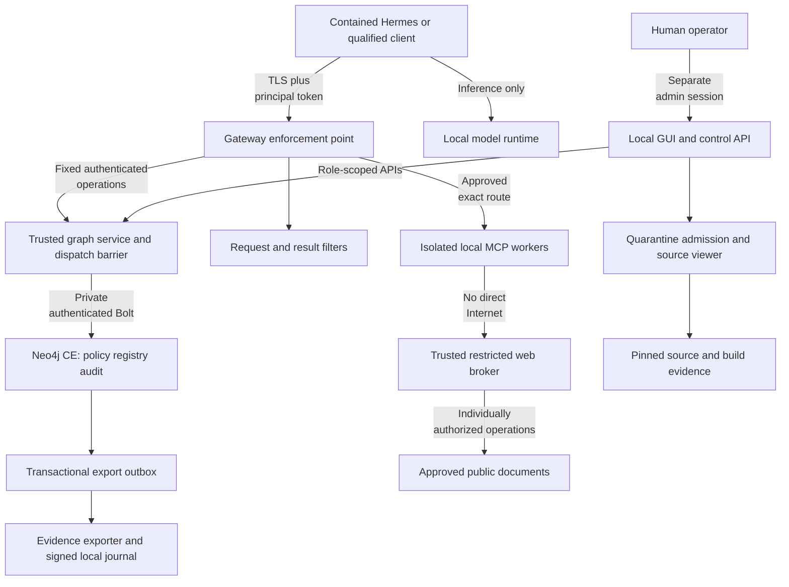
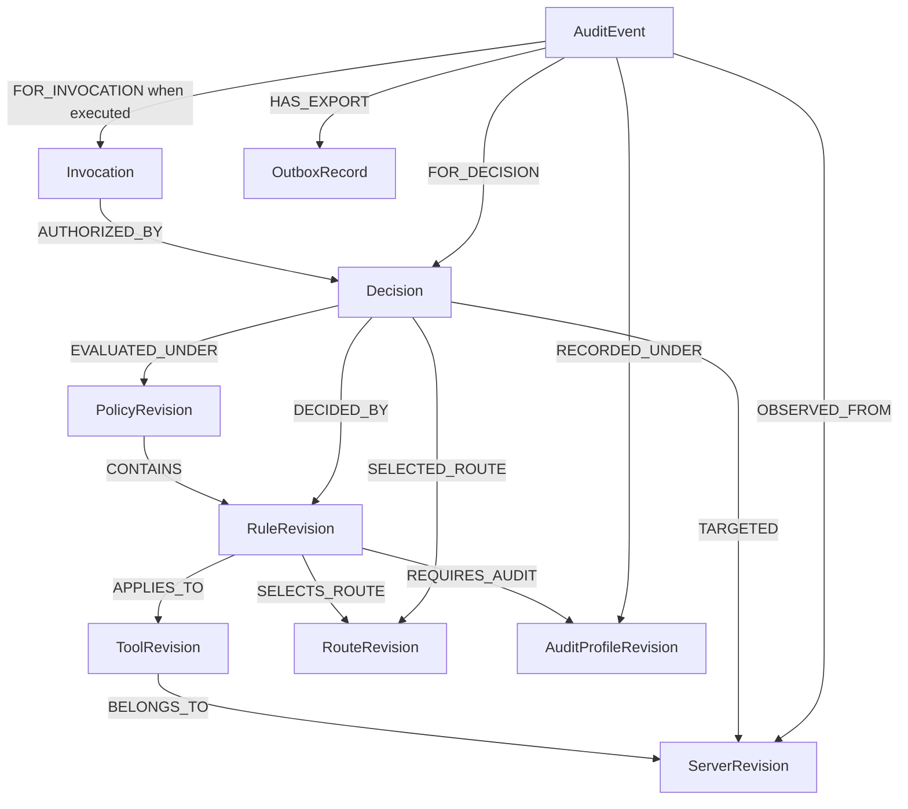

# Secure Local MCP Gateway — Architecture

**Architecture revision:** 2.0  
**Date:** 2026-10-04 (America/New_York)  
**Requirements baseline:** [MCP_Gateway_SRS.md — V1](MCP_Gateway_SRS.md)  
**Immutable SRS baseline:** [versions/MCP_Gateway_SRS_V1.md](versions/MCP_Gateway_SRS_V1.md)  
**Status:** Proposed design; no application, Neo4j instance, MCP server or client configuration was installed by this documentation revision.

## 1. Document authority and design decisions

The SRS defines what the system must achieve and how satisfaction will be verified. This architecture defines the selected components, data model, interactions, server sources and integration procedures. It does not maintain a second competing set of requirement IDs. References such as “SRS §1” identify the corresponding requirement hierarchy, not a claim that the design has passed its tests.

This revision supersedes the combined specification/architecture dated 2026-10-04, preserved as `archive/architecture-pre-srs-v1-2026-10-04.md`. The earlier September architecture and research brief remain historical inputs. All development and documentation remain in this repository.

| Decision | Selected design and reason |
|---|---|
| Policy authority | Neo4j Community Edition stores the active rules, exact routes and audit obligations. The previous Casbin policy authority is removed from the baseline. |
| Rule execution | A small deterministic graph service interprets typed policy records using fixed parameterized queries. The graph determines the decisions through these records; Neo4j does not intercept MCP traffic or invent authorization semantics by itself. |
| Audit storage/search | Neo4j stores decision/event metadata and historical relationships. Encrypted local blobs hold optional payload bodies. A signed local evidence journal provides an independent tamper-evidence copy, not a competing policy store. |
| Enforcement | Go gateway plus official MCP SDK; admission, authentication, argument checks, filters, dispatch and release gates remain explicit. Graph reachability or search scores cannot grant authority. |
| User interface | Local React GUI with an inert source viewer, structured rule editor, graph relationship explorer, simulator and audit browser. Neo4j Browser/Desktop/Bloom is not the gateway control interface. |
| Deployment | Single workstation, isolated processes/rootless OCI workers, one protected CE database instance. No Enterprise features, Aura, paid APIs, SaaS accounts or proprietary desktop products are required. |
| Source admission | Curated packages are candidates, never automatically trusted. Exact source, build and runtime identities must be inspectable before allowlisting. |
| Initial useful scope | Read-only project files, local Git review, local document conversion/search and constrained local tabular analysis. Higher-risk editing/code/browser/CAD functions are separately admitted. |

Neo4j is selected for the requested relationship model and explainability, not because it is a substitute for OS isolation or a ready-made policy product. The baseline is feasible for a single host if the Community Edition limits in section 2 are accepted. The design fails closed during graph maintenance/outage; uninterrupted high availability is not promised.

## 2. Neo4j Community Edition feasibility and limitations

Primary sources were consulted on 2026-10-04. Implementation freezes one exact CE release, JDK build, Go driver and source/image digests after qualification; rolling documentation is not a version pin.

| Area | Verified CE boundary | Architecture response |
|---|---|---|
| License | CE is GPLv3; source is inspectable | Deploy the standalone CE distribution, retain source/notices for applicable distribution obligations; exclude Enterprise/Aura dependencies. [License](https://github.com/neo4j/neo4j/blob/2026.09/LICENSE.txt), [OSS project](https://neo4j.com/open-source-project/) |
| Database count | One standard user database plus `system` | Store policy, registry and audit in one `neo4j` database. Labels organize records; they do not isolate access. [Database administration](https://neo4j.com/docs/operations-manual/current/database-administration/) |
| Access control | Enterprise supplies fine-grained roles/privileges; CE has limited user management | A single trusted graph service holds application DB credentials; GUI roles are enforced by its API. Do not claim read-only auditor DB accounts or label-level security in CE. [Authorization](https://neo4j.com/docs/operations-manual/current/authentication-authorization/) |
| Native auditing | `security.log` and `query.log` are Enterprise features in current documentation | Gateway events form the audit system; ordinary database logs are only operations diagnostics. [Logging](https://neo4j.com/docs/operations-manual/current/monitoring/logging/) |
| Backup | CE dump is offline; online backup is Enterprise | Stop dispatch, drain work, stop the DBMS and use a tested offline dump/restore plan. Back up configuration/security state separately as required. [Offline backup](https://neo4j.com/docs/operations-manual/current/backup-restore/offline-backup/) |
| Constraints | Uniqueness is available; existence/type/key constraints have Enterprise restrictions | Use ID uniqueness plus application validation of required fields, types, enums and relationship cardinalities. A unique property can still be absent. [Constraints](https://neo4j.com/docs/cypher-manual/current/schema/constraints/create-constraints/) |
| Transactions | ACID with read-committed behavior, not automatic serializable authorization | Immutable revisions plus one dispatch/publication barrier close policy races; external tool execution stays outside retryable transaction callbacks. [Concurrency](https://neo4j.com/docs/operations-manual/current/database-internals/concurrent-data-access/) |
| Search | Full-text indexes may be configured eventually consistent | Use full-text only for operator discovery; exact indexed graph queries govern access. [Full-text indexes](https://neo4j.com/docs/cypher-manual/current/indexes/semantic-indexes/full-text-indexes/) |
| Resilience | No baseline automatic cluster/HA | One instance is an availability dependency. Stop new dispatch on failure; do not fall back to stale permissive rules. [Edition information](https://neo4j.com/pricing/) |
| Runtime and telemetry | Current requirements support OpenJDK 21/25; usage reporting defaults on | Select an OSS OpenJDK build; set `dbms.usage_report.enabled=false` and deny DB Internet egress. [Requirements](https://neo4j.com/docs/operations-manual/current/installation/requirements/), [setting](https://neo4j.com/docs/operations-manual/current/configuration/configuration-settings/#config_dbms.usage_report.enabled) |

A compromised graph service can modify both policy and audit because CE cannot enforce the desired fine-grained separation inside that shared database. This is an explicit trusted-computing-base risk. Protected source/configuration, fixed APIs, separate identities, restricted listeners and independently stored signed checkpoints reduce exposure; they do not defeat a hostile host administrator. If future assurance requires database-enforced separation or high availability, revisit the architecture using another fully OSS design rather than silently adding paid Neo4j features.

## 3. Components and trust boundaries



The graph service exposes typed operations (`EvaluateAndRecord`, `PublishPolicy`, `ConsumeApproval`, `RecordOutcome`, `QueryAudit`, `GetServerEvidence`) over protected local IPC. It is the only normal process with authoritative Neo4j credentials. The GUI and MCP-facing gateway never receive a generic Cypher console or raw DB credentials. Each operation authorizes the calling service/operator before selecting a fixed query template.

| Component | Runtime authority |
|---|---|
| Gateway | Verify client credentials, request graph decisions, dispatch approved routes, enforce filters; no arbitrary Internet or direct policy mutation |
| Graph service | Sole application DB credential; schema validation, deterministic policy evaluation, publication barrier, audit transactions; largest application trust boundary |
| Control API | Authenticate human administrators/auditors; call role-specific graph APIs; no database password in browser JavaScript |
| Admission worker | Disposable sandbox, synthetic fixtures, no production mounts/secrets/network; source preview never executes code |
| Supervisor | Execute only admitted manifests; protected API supplies exact executable/image and argument array, not arbitrary commands or a container-engine socket |
| MCP worker | One trust-scoped identity, approved read-only/project mounts, bounded scratch, explicit resource/egress profile |
| Trusted web broker | One-use request authorization; checked destination resolution/redirects; record actual outbound operations |
| Audit exporter | Read committed outbox through a narrow graph-service API; own evidence-signing credential; idempotent local segment export |
| Local inference | Approved model and runtime without autonomous browsing, tool plugins or provider fallback |

Production state belongs in protected locations such as `/etc/smcp`, `/var/lib/smcp` and `/run/smcp`, outside the agent-writable source project. Neo4j data, backups and credentials are not mounted into agents, backend servers or source viewers. Private HTTP/Bolt listeners are not published to the agent network or ordinary LAN. TLS validates the actual names/interface used. An isolated container’s `127.0.0.1` is not the host’s loopback; deployment supplies a constrained relay or dedicated gateway interface with a matching certificate.

Agent network access is limited to the MCP façade and local inference endpoint. Backend network access is individually constrained. Rules cover IPv4/IPv6, DNS/DoH, UDP/QUIC, host aliases, bridge/FORWARD traffic, rootless networking and local sockets. No host networking, container-engine socket, sudo, shared SSH agent, desktop-control socket or host PID namespace is available. A bare chroot, stdio transport or configured HTTP proxy is not a complete sandbox.

**SRS allocation:** §2 identity; §4 containment; §7 operations.

## 4. Graph rule system and routing model

### 4.1 Graph schema

Stable identities are distinct from immutable revisions. A server display-name change does not alter its identity; an artifact/tool change creates a new reviewed revision. All application IDs are generated by the trusted service and uniqueness-constrained. The publisher checks property presence/type, permitted edge types, acyclicity of the supported publication structure and cardinality; these checks do not rely on Enterprise-only constraints.

| Node | Essential properties / purpose |
|---|---|
| `Principal`, `CredentialReference` | Principal ID, enabled state, credential verifier/reference, expiry, revocation epoch; no plaintext key |
| `Server`, `ServerRevision` | Stable ID; source URL/commit/tree digest, local patch digest, artifact/image digest, manifest digest, admission status and expiry |
| `ToolRevision` | Exact public/backend names, method, schema/description digests, operator risk class and server-version binding |
| `PolicyControl` | Singleton active revision ID and revocation/stop epoch; coordinated publication state |
| `PolicyRevision` | Immutable ID, digest, schema version, parent revision, publication actor/time and approved fixture results |
| `RuleRevision` | Immutable rule ID/version, effect (`permit`/`deny`), typed predicates and exact subject/target scope |
| `RouteRevision` | Exact transport, admitted executable/endpoint identity, server/tool version, sandbox profile and secret references |
| `AuditProfileRevision` | Mandatory metadata class, optional capture mode, local storage class, retention bounds, redaction profile and alert rules |
| `FilterProfileRevision` | Ordered required/observational filters, versions and bounded budgets |
| `Approval` | One-use binding to principal and exact server/tool/route revisions, final argument digest, policy revision, actor, expiry and consumed state |
| `HandleContractRevision` | Declared handle-creation output paths, consumer argument paths/operations, ownership scope, expiry and qualified enforcement adapter |
| `Decision`, `Invocation` | Outcome/reason, request commitment, evaluated revision, considered/applicable/decisive rules, selected route; invocation lifecycle |
| `AuditEvent`, `PayloadReference` | Event identity/phase/origin, metadata, payload ciphertext digest/key reference/expiry; no raw credential or decryption key |
| `OutboxRecord`, `Checkpoint` | Event export/reconciliation state, independent evidence segment/checkpoint reference |
| `SystemControl`, `UnresolvedTarget` | Stable reasons for invalid auth/default deny/unknown targets; no invented server execution |



Every evaluated-request event links directly to its `Decision` using `FOR_DECISION`; only authorized execution phases additionally link to an `Invocation`. Known-target denials therefore appear in the server history without implying that a call executed. Additional edges record `CONSIDERED_RULE`, `APPLICABLE_RULE`, `REQUIRES_FILTER`, source/build evidence, actor and approvals. `OBSERVED_FROM` is used only when the gateway actually observed that backend connection. A denied call may have `TARGETED` a server without `OBSERVED_FROM` that server. Server-supplied log messages are marked `server_asserted`; their claims do not change the trusted connection identity or prove execution.

### 4.2 Policy language and deterministic evaluation

The graph stores structured rules, not free-form Cypher or natural-language instructions. V1 predicate types are: exact equality/set membership; numeric inclusive range; canonical path containment; validated scheme/host/port membership; data-class membership; UTC expiry interval; required approval state. Regex/secret detectors belong to reviewed filter profiles, not user-defined database code. Role membership is a bounded direct mapping in V1; nested role graphs and unbounded recursive paths are excluded.

Evaluation sequence:

1. Derive principal from verified credentials; normalize method/tool/arguments under the approved schema.
2. Resolve the internal tool and server revision by exact identity; verify credential/principal/admission state.
3. Load one current immutable revision and no more than 256 candidate rules through bounded indexed templates.
4. Evaluate typed predicates. Missing attributes, malformed rules, broken references, excess matches or timeout deny.
5. Apply any applicable explicit deny. Otherwise require an explicit permit whose complete scope matches.
6. Combine obligations conservatively. If there is no unique approved route, deny rather than use ordering, a “nearest” graph match or an unreviewed fallback.
7. Apply required request filters and any approval workflow; reauthorize final canonical arguments after transformation.
8. Enter the dispatch/publication barrier, recheck revision/epochs, commit the linked decision and intent, and hand the launch authorization to the dispatcher under the same barrier.
9. On result, filter, then enter the same coordinator barrier to recheck current authority, commit outcome/release authorization and hand the buffered content to the sender. Actual delivery completion is observed separately.

| Concern | Combination / precedence |
|---|---|
| Authority | Failed mandatory prerequisite or any matching deny wins; no explicit permit means deny |
| Scope | Each permit must match the complete request; ambiguous partial/overlapping scopes are rejected at publication, not unioned into a larger grant |
| Route | Exactly one immutable route after evaluation; multiple different routes are a publication/evaluation error |
| Required filters | Union of required controls; observation-only rules cannot weaken a required filter |
| Size/rate/time/resource limits | Smallest applicable bound |
| Metadata audit | Mandatory system floor; no ordinary rule can disable it |
| Payload capture | No-capture classification wins; otherwise opt-in capture only for a published approved profile; a mandatory-capture/no-capture conflict blocks publication |
| Retention | Apply maximum of applicable minimum-retention obligations and minimum of applicable maximum-retention limits; if minimum exceeds maximum, reject publication |
| Storage destination | Select an administrator-defined local storage-class ID; a policy cannot supply an arbitrary filesystem path, URI or shell command |
| Approval | Most restrictive applicable approval requirement; final argument digest/revision and one-use expiry remain binding |

Full-text, graph visualization layout and vector similarity are operator conveniences only. They cannot select a permit or route. V1 uses no vector index or model reasoning in the authorization path. The evaluator is versioned with the rule schema and included in release tests; changing it creates a new qualification baseline.

### 4.3 Race control and side effects

Neo4j ACID is not a substitute for dispatch ordering. One graph-service coordinator owns policy activation, key revocation, emergency stop, launch authorization and buffered-result release authorization. The service runs as a single writer in V1; direct database writers are prohibited outside stopped maintenance. An application gate and an explicit transactional write/lock on the policy-control record order relevant operations. Queued requests re-evaluate after a revision change.

The dispatch linearization point is the committed authorization-to-launch handoff while holding the coordinator gate. The corresponding release point is the committed authorization-to-send handoff of a screened buffer under that same gate; a later revocation cannot recall bytes already handed off. Work handed off before a revocation is in flight; revocation blocks later authorizations and requests cancellation of earlier work. The GUI does not claim that it can undo a side effect already authorized. Startup invalidates outstanding unconsumed launch capabilities; recovery does not replay a possibly executed mutation.

The [Go driver may retry managed transaction callbacks](https://neo4j.com/docs/go-manual/current/transactions/). No MCP invocation, public HTTP request, filesystem mutation or signature-export side effect occurs inside such a callback. Application-issued decision/event IDs plus uniqueness checks make retrying graph writes idempotent. “Exactly once” external tool execution is not promised.

### 4.4 Example audit traversal

This example is an **operator audit lookup**, not an authorization implementation or exposed arbitrary-query endpoint. `$server_revision_id` and `$limit` are validated parameters supplied by the graph service; the query template is fixed and bounded.

```cypher
MATCH (d:Decision)-[:TARGETED]->(s:ServerRevision {id: $server_revision_id})
MATCH (e:AuditEvent)-[:FOR_DECISION]->(d)
OPTIONAL MATCH (d)-[:DECIDED_BY]->(r:RuleRevision)
RETURN e.id AS event_id, e.timestamp AS timestamp, d.outcome AS outcome,
       s.id AS server_revision, collect(DISTINCT r.id) AS decisive_rules
ORDER BY timestamp DESC
LIMIT $limit
```

Invalid-key events and unknown targets use separate fixed queries over `SystemControl`/`UnresolvedTarget`. An authentication failure before evaluation or a graph-outage spool record carries `policy_status=not_evaluated` or `unavailable`, a versioned system-control reason, and an explicitly non-authoritative last-known revision only when available. Reconciliation preserves that original uncertainty rather than attaching the subsequently active policy as if it had been evaluated. The API caps result count, query duration and permitted filters. No agent-controlled label, relationship type, procedure name or query text is concatenated into Cypher.

**SRS allocation:** §1 graph policy/routing; §6 audit relationships; §7 transaction safety.

## 5. Policy-directed audits and storage consistency

Neo4j is the primary store for searchable event metadata and relationships. A rule’s `REQUIRES_AUDIT` edge chooses a versioned audit profile. Every decision produces the mandatory event floor, while the profile chooses additional detail, capture scope, classification, retention, alerting and an approved local storage class. Payload bodies remain age-encrypted outside the graph with digests and key references recorded as nodes.

The record sequence is `requested → denied` or `requested → authorized → dispatched → completed/failed/indeterminate → filtered → delivered/withheld`. These are observed phases, not inferred success. Each phase shares a correlation ID. Administrative actions, filter blocks, authentication failures, admission drift and graph failures also produce events.

Before dispatch, a single Neo4j transaction commits the decision, invocation intent, exact historical rule/server/tool/filter/audit-profile links and export-outbox entry. Before result release, another transaction commits outcome/release authorization evidence under the coordinator barrier. Actual successful delivery, if observed, is recorded as a later event; authorization does not claim delivery already occurred. A denied request with an unknown target links to a stable system rule and unresolved target, never a fabricated server result.

An outbox exporter writes signed chained local evidence segments and records export receipts idempotently. There is no atomic transaction spanning Neo4j and a JSONL file. Normal export target is within five seconds; lag beyond 60 seconds or 1,000 events stops new dispatch. Reconciliation detects missing/duplicate events and validates sequence/checkpoints. During DB outage a bounded protected diagnostic spool stores failure/deny events only; it does not grant access or accept tool execution for later replay.

Independent checkpoints belong in operator-controlled storage outside the graph-service account’s write authority, with periodic offline copies. This provides tamper evidence against some service/database compromises; Neo4j remains mutable and host-root compromise remains outside the guarantee. Exporter and DB error text are redacted like other logs.

Defaults: 90 days metadata, seven days optional redacted payload, a maximum 24-hour temporary payload-capture window, 10 GiB combined audit/evidence quota pending capacity qualification, warning at 80%, and a stop before durable intent can no longer be written. Referenced immutable versions are retained until dependent audit retention ends. Purge is an authenticated workflow with a deletion receipt; it cannot promise erasure from SSD cells or backups. A pure graph “delete server” operation never relinks history to its replacement.

**SRS allocation:** §6 audit; §7 recovery. Neo4j native Enterprise audit features are not used.

## 6. MCP, filtering and execution paths

The official Go SDK handles JSON-RPC/framing and separately qualified current **2026-07-28** and legacy **2025-11-25** profiles. Current MCP is per-request/stateless; legacy initialization and session behavior remain only in the legacy adapter. Required modern mirrored headers are checked against parsed bodies before routing. Recognized errors cannot trigger a weaker fallback. [Current HTTP](https://modelcontextprotocol.io/specification/2026-07-28/basic/transports/streamable-http), [versioning](https://modelcontextprotocol.io/specification/2026-07-28/basic/versioning), [SDK](https://github.com/modelcontextprotocol/go-sdk/blob/main/docs/protocol.md).

V1 exposes qualified tools/discovery and necessary lifecycle operations. Resources, prompts, sampling, elicitation, roots/list and modern root-input interactions, subscriptions and task/continuation features are not advertised until their complete paths pass dedicated tests. Each request is authenticated; principal/roles come only from verified credentials and protected mappings. State handles and legacy sessions are owner-bound through admitted versioned handle contracts; undeclared handle semantics are not inferred from arbitrary strings and uncontracted stateful tools remain unadmitted. Catalogs and caches are scoped to principal and active policy revision, with non-public caching directives.

Outbound checks cover typed arguments, URLs, query text, bodies and headers before side effects. The worker has no direct Internet; a trusted broker checks a one-use gateway-issued authorization for each operation and redirect. It canonicalizes scheme/host/port, validates resolved IPv4/IPv6 addresses at connection time, denies private/reserved/metadata destinations except exact admitted engineering-service exceptions, and validates TLS. Public GET-only fetching has no ambient cookies, arbitrary Authorization, uploads, CONNECT tunnel or page script execution.

Inbound processing validates the response envelope, request correlation and declared approved output schema, then buffers a bounded complete result before content release. Filters inspect text, structured fields, embedded resources, errors, logs and other enabled surfaces. Unsupported binaries/media/archives are blocked unless an admitted extraction worker supplies a bounded representation. Required-filter failure blocks. Redaction is schema-aware; changed action-defining arguments need new authorization/approval. Unicode checks distinguish malicious controls from legitimate engineering code and multilingual text. Provenance survives transformation; a detector never certifies an instruction safe or grants authority.

The local server credential is different from the client credential. Secrets are injected only into the owning worker. The service never executes a user-supplied shell command to launch an MCP server. Generic code-execution and browser tools remain high-risk even when reached through the gateway.

**SRS allocation:** §2 credentials; §4 containment; §5 protocol/content controls.

## 7. GUI: policy, source inspection and audit investigation

The local GUI includes server catalog, source evidence, principal registry, rule editor, graph explanation, filter workbench, audit search, secrets, approvals, health and emergency stop. Graph visualization is generated from bounded typed API responses; it is not an embedded Cypher console.

| Role | Allowed operations | Excluded operations |
|---|---|---|
| Administrator | Inspect sources/audits, characterize/admit servers, create/publish policy, issue/revoke keys, approve sensitive actions, manage retention and emergency stop | Direct DB/host shell through ordinary GUI; source preview execution |
| Auditor | Read admitted metadata, source evidence, rule history and redacted audit; request permitted redacted exports | Policy publication, admission approval, key creation, secret changes, payload access unless separately granted, purge |
| MCP principal | Discover/call its permitted tool catalog | All control-plane, policy-write, source-admission, secret and audit-administration operations |

These are application roles; CE does not enforce them as database roles. The control API verifies them independently of browser controls. Separate protected admin sessions, Argon2id verifiers, CSRF tokens, exact Origin/Host handling, CSP and revision preconditions protect mutations.

### 7.1 Source inspection and admission workflow

1. Register a candidate’s repository/package and exact revision in quarantine. Fetch only through the controlled maintenance process, never during tool invocation.
2. Cache the source tree and license/NOTICE files locally. Record URL, owner, commit/tag, source-tree digest, local patches, dependencies/lockfiles, build recipe, SBOM, advisories and runtime/image digest.
3. Show searchable file contents and diffs as escaped text. Block traversal paths, symlink escapes, active HTML, notebooks/macros, repository hooks, installation scripts and automatic remote images. Viewing source never runs it.
4. Show entrypoints, tool names/schemas/descriptions, claimed annotations, actual mounts/egress/secrets, telemetry settings and subprocess behavior beside the source. An annotation such as “read-only” is a claim to verify.
5. Probe in a networkless disposable sandbox with synthetic inputs. Compare observed behavior to declared scope; retain findings and review status. Fixtures needing a local test service get a bounded explicit test-only network grant.
6. Bind human approval to source/build/runtime/manifest digests and sandbox settings. Use self-built artifacts or adequate reproducible/provenance evidence; a link to source next to an unrelated binary is insufficient.
7. Publish exact tool-scoped rules and routes. Candidate presence, a passing scan or an upstream “official” label does not enable execution.
8. On source/dependency/artifact/manifest/security-configuration change, show the diff and invalidate admission until re-reviewed. Re-review date defaults to 90 days, earlier for new advisories or changes.

### 7.2 Graph-led investigation

From a server card, the operator can select **Rules affecting this server**, **Effective tools by principal**, **Source/version history** and **Audit events**. From an event, the operator can open the exact historical rule, effective audit/filter profile, server artifact and related invocation phases. Denied, unresolved and server-asserted events have visibly different origin labels. Full-text helps find records; exact IDs drive the explanation.

Policy editing uses structured fields and typed predicates. Before publication the GUI shows scope changes, route ambiguity, filter/audit obligations, synthetic simulation results and affected clients. It does not expose raw Cypher, filesystem destinations or arbitrary graph edges. Approval classes are frozen in SRS Appendix F: separately admitted file/Git/database/CAD mutations, sensitive exports, external uploads/POST and general code execution need exact-request one-use approval. Approval cannot replace admission or a permit. The emergency stop uses the same dispatch barrier as revocation.

Proposed project API operations: `/api/v1/servers`, `/api/v1/source-evidence/{id}`, `/api/v1/policies/simulate`, `/api/v1/policies/publish`, `/api/v1/decisions/{id}/explanation`, `/api/v1/audit`, `/api/v1/approvals`, `/api/v1/credentials`, `/api/v1/health`, `/api/v1/emergency-stop`. These are design contracts, not installed endpoints.

**SRS allocation:** §3 source admission; §6 audit; §8 operator product.

## 8. Curated local engineering MCP server catalog

**Admission status for every entry below: not installed and not security-qualified by this task.** “Initial candidate” means worth qualifying first, not preapproved. Versions/commits remain pending admission so research does not masquerade as a reviewed build. Production execution uses a fixed local artifact, never `npx ...@latest`, floating `uvx`, a mutable container tag or an automatically updating marketplace entry.

The official MCP reference repository describes its servers as educational examples rather than production-ready products. Its root license is transitioning from MIT to Apache-2.0 while some package/per-file notices remain MIT; retain the exact notices at the chosen commit. [Reference warning](https://github.com/modelcontextprotocol/servers/blob/main/README.md), [license](https://github.com/modelcontextprotocol/servers/blob/main/LICENSE), [security advisories](https://github.com/modelcontextprotocol/servers/security).

| Catalog ID / tier | Engineering function and actual source | License / local dependencies | Intended exposure and required restrictions |
|---|---|---|---|
| ENG-01 — initial candidate | Project files: [`modelcontextprotocol/servers/src/filesystem`](https://github.com/modelcontextprotocol/servers/tree/main/src/filesystem), package `@modelcontextprotocol/server-filesystem` | Applicable Apache-2.0/MIT notices during repository transition; Node runtime | Read/list/search only at first; administrator-approved read-only project mounts. Client-supplied MCP roots cannot widen permitted roots. Test symlink/path escapes and patch advisories. Offline. |
| ENG-02 — initial candidate | Local Git history/diffs: [`modelcontextprotocol/servers/src/git`](https://github.com/modelcontextprotocol/servers/tree/main/src/git), package `mcp-server-git` | Package [MIT](https://raw.githubusercontent.com/modelcontextprotocol/servers/main/src/git/LICENSE) plus applicable repository notices; Python and Git | Status/log/show/diff only; no remote credentials/network, init, add, commit, checkout or reset. Suppress external diff, textconv, fsmonitor and unsafe hooks/configuration through a reviewed wrapper/environment. Repository config is untrusted. Offline. |
| ENG-03 — initial candidate | PDF/DOCX/spreadsheet/presentation extraction: [`microsoft/markitdown/packages/markitdown-mcp`](https://github.com/microsoft/markitdown/tree/main/packages/markitdown-mcp), package `markitdown-mcp` | [MIT](https://github.com/microsoft/markitdown/blob/main/LICENSE); Python and qualified local parsers | Limit `convert_to_markdown(uri)` to approved local `file:` roots; block URL/data inputs. No Azure, hosted LLM, YouTube or unreviewed plugins. No network; bound parser memory/time/file size. Gateway-managed stdio avoids exposing its unauthenticated service. Offline. |
| ENG-04 — initial candidate after SQL tests | CSV/Parquet/local SQL analysis: [`motherduckdb/mcp-server-motherduck`](https://github.com/motherduckdb/mcp-server-motherduck), package `mcp-server-motherduck` | MCP server [MIT](https://github.com/motherduckdb/mcp-server-motherduck/blob/main/LICENSE); [DuckDB MIT](https://github.com/duckdb/duckdb/blob/main/LICENSE) | Configure a local DuckDB file; no MotherDuck account/token, `md:` connection, S3 or database switching. Read-only DB mode is insufficient: restrict files, extensions, configuration changes and query complexity in the worker. Use a separate controlled ingestion step, then sealed query mode. Offline. |
| ENG-05 — optional engineering graph | Engineering assets/BOM/requirements data: official [`neo4j/mcp`](https://github.com/neo4j/mcp), executable source `cmd/neo4j-mcp` | [GPLv3](https://github.com/neo4j/mcp/blob/main/LICENSE.txt), [NOTICE](https://github.com/neo4j/mcp/blob/main/NOTICE.txt); separate Neo4j CE domain instance | Use only a separate domain-data instance, never the gateway policy/audit database. Qualify `NEO4J_MCP_READ_ONLY=true` and `NEO4J_MCP_TELEMETRY=false` for the pinned release; disallow unsafe/custom procedures. Read-only MCP flags do not create CE DB privilege isolation. Offline/local private network. |
| ENG-06 — optional source for controlled-fetch adapter | Public engineering manuals: [`modelcontextprotocol/servers/src/fetch`](https://github.com/modelcontextprotocol/servers/tree/main/src/fetch), package `mcp-server-fetch` | Package [MIT](https://raw.githubusercontent.com/modelcontextprotocol/servers/main/src/fetch/LICENSE) plus applicable repository notices; Python HTTP/parsing stack | Reference/adaptation source only for the broker-integrated capability. Raw upstream behavior can reach internal IPs. It is not admitted unchanged if it cannot delegate each authorized operation to the broker. No direct Internet route; approved public HTTPS documents only. Disabled in offline profile. |
| ENG-07 — optional local test browser | Local web-application testing: [`microsoft/playwright-mcp`](https://github.com/microsoft/playwright-mcp), package `@playwright/mcp` | [Apache-2.0](https://github.com/microsoft/playwright-mcp/blob/main/LICENSE); Node and separately inventoried OSS browser | Disposable Chromium profile with sandbox enabled; no user browser, cookies, extensions, CDP session or SaaS login. Network namespace limits access to admitted test-app origins. Gate JS, uploads/downloads and file access. Origin flags alone are not an egress boundary. |
| ENG-08 — optional CAD laboratory | FreeCAD model inspection: [`neka-nat/freecad-mcp`](https://github.com/neka-nat/freecad-mcp), package `freecad-mcp`, addon `addon/FreeCADMCP` | Adapter [MIT](https://github.com/neka-nat/freecad-mcp/blob/main/LICENSE); FreeCAD [LGPL-2.0-or-later and component notices](https://github.com/FreeCAD/FreeCAD-documentation/blob/main/wiki/License.md) | Separate FreeCAD worker and private bridge with copied project inputs. Begin with `list_documents`, `get_object`, `get_objects`, `get_view`; reject arbitrary `execute_code` variants and broad mutation. Treat CAD document loading as untrusted parsing. Offline. |
| ENG-09 — proposed custom adapter | Offline code/document search around [ripgrep](https://github.com/BurntSushi/ripgrep) and SQLite FTS5 | Proposed adapter Apache-2.0; ripgrep [MIT OR Unlicense](https://github.com/BurntSushi/ripgrep/blob/master/COPYING); SQLite [public domain](https://sqlite.org/copyright.html) | Not yet implemented. Approved indexed roots, bounded text results and per-query document authorization. No shell/unspecified CLI flags or hosted embeddings. SQLite here is an isolated engineering search corpus, not gateway policy/audit authority. Offline. |
| ENG-10 — proposed custom adapter | Unit conversion, formula and numerical analysis around SymPy, NumPy and Pint | Proposed adapter Apache-2.0; [SymPy BSD-3-Clause with notices](https://github.com/sympy/sympy/blob/master/LICENSE), [NumPy BSD-3-Clause](https://github.com/numpy/numpy/blob/main/LICENSE.txt), [Pint BSD-3-Clause](https://github.com/hgrecco/pint/blob/master/LICENSE) | Not yet implemented. Typed unit/matrix/statistical operations and allowlisted expression AST; no arbitrary Python, eval/imports or unsafe symbolic parsers. Bound symbolic complexity/time/memory; return units, precision and provenance. Offline. |
| ENG-11 — proposed custom adapter | KiCad ERC/DRC, BOM and fabrication exports around [`kicad-cli`](https://docs.kicad.org/9.0/en/cli/cli.html); [source mirror](https://github.com/KiCad/kicad-source-mirror) | Proposed adapter Apache-2.0; KiCad [predominantly GPL-3.0-or-later, libraries CC-BY-SA-4.0](https://www.kicad.org/about/licenses/) | Not yet implemented. Version-qualified allowlisted CLI subcommands, read-only input copies, job-specific output directory; no shell, arbitrary BOM scripts, plugins or jobsets. Review file licenses separately. Offline. |

### 8.1 Recommended qualification order

1. Qualify ENG-01 and ENG-02 with read-only fixtures and current patched revisions.
2. Qualify ENG-03, then implement ENG-09 to search approved local manuals, requirements and code. Conversion is not equivalent to document editing or guaranteed OCR; add a separately licensed local OCR dependency only when required.
3. Qualify ENG-04 for a sealed, local analysis database. Do not treat SQL `SELECT`/read-only mode as safe filesystem or extension access. A restricted project-owned SQLite/DuckDB query adapter is the fallback if the upstream server cannot satisfy the constraints.
4. Implement ENG-10 for bounded engineering mathematics before introducing an unrestricted notebook/code executor.
5. Add ENG-08/ENG-11 for the operator’s actual CAD/electronics workflow, with copy-in/copy-out projects and explicit write approval.
6. Enable ENG-07 only for owned local application testing. Add ENG-06 only when public-web access is requested; no SaaS account or hosted search subscription is implied.
7. Add ENG-05 only for a separate engineering knowledge graph. The gateway’s policy/audit graph is never exposed as a general-purpose agent database.

These sources are inspectable and licensed for an OSS implementation, but inspectability does not prove correctness or security. Each registry entry includes reviewer, maintained/archived status, open advisories, source/build/runtime digests and expiry. Archived reference SQLite/PostgreSQL servers are not recommended as maintained production dependencies. Generic GitHub/Jira/Slack/Drive/cloud-storage connectors are intentionally outside this non-SaaS catalog.

### 8.2 Definition of local and non-SaaS

“Offline” means runtime operation needs no network outside the admitted local environment. “Local network” means a specific owned service such as a test app or separate domain database. “Approved public Internet” means reading public documents through the broker without service-account credentials; it is optional and not part of offline acceptance. Package retrieval and source updates occur only during controlled maintenance, with retained local artifacts for subsequent offline use.

**SRS allocation:** §3 inspectable admission; §9 engineering functions and software constraints.

## 9. Technology stack and licenses

The table identifies direct choices; release qualification inventories transitive dependencies, image layers, native libraries and browser components. GPL/MPL/AGPL and attribution obligations are handled for the selected distribution/modifications; no blanket license-compatibility conclusion is implied.

| Component | Purpose | License / source |
|---|---|---|
| Project gateway/control/graph service/broker | Go application with fixed typed APIs | Proposed Apache-2.0 for project-authored code; final owner release choice |
| Neo4j Community Edition | Authoritative policy, registry, routing and audit graph | [GPLv3](https://github.com/neo4j/neo4j/blob/2026.09/LICENSE.txt) |
| OpenJDK 21 compatible OSS build | Neo4j runtime | [GPL-2.0 with Classpath exception for marked files](https://github.com/openjdk/jdk21u/blob/master/LICENSE), [additional notices](https://github.com/openjdk/jdk21u/blob/master/ADDITIONAL_LICENSE_INFO) |
| Neo4j Go driver | Parameterized transactions and queries | [Apache-2.0](https://github.com/neo4j/neo4j-go-driver/blob/6.x/LICENSE) |
| Go | Gateway/service runtime and build | [BSD-3-Clause](https://go.dev/LICENSE) |
| Official MCP Go SDK | MCP transport/version implementation | [Apache-2.0 transition with retained MIT contributions and separate doc terms](https://github.com/modelcontextprotocol/go-sdk/blob/main/LICENSE); preserve pinned-release notices |
| React / TypeScript / Vite / Node | Local GUI; Node build-time only for gateway GUI | [React MIT](https://github.com/facebook/react/blob/main/LICENSE); [TypeScript Apache-2.0](https://github.com/microsoft/TypeScript/blob/main/LICENSE.txt); [Vite MIT](https://github.com/vitejs/vite/blob/main/LICENSE); [Node MIT plus bundled notices](https://github.com/nodejs/node/blob/main/LICENSE) |
| Cytoscape.js | Bounded local graph visualization | [MIT](https://github.com/cytoscape/cytoscape.js/blob/unstable/LICENSE); graph data comes from role-filtered typed API responses |
| age / Go x/crypto | Secret/payload encryption; Argon2id password verifiers | [age BSD-3-Clause](https://github.com/FiloSottile/age/blob/main/LICENSE); [x/crypto BSD-3-Clause](https://go.googlesource.com/crypto/+/refs/heads/master/LICENSE) |
| Podman | Rootless OCI workers | [Apache-2.0](https://github.com/containers/podman/blob/main/LICENSE) |
| Linux/systemd/nftables/AppArmor | Isolation, lifecycle and network enforcement | Package-specific GPL/LGPL and exception notices; nftables GPL-2.0-only with some later-version files. Preserve installed package copyright manifests. |
| Hermes Agent | Primary local agent | [MIT](https://github.com/NousResearch/hermes-agent/blob/main/LICENSE); model weights have separate terms |
| llama.cpp | Proposed local inference default | [MIT](https://github.com/ggml-org/llama.cpp/blob/master/LICENSE); qualify tool-capable model weights and hardware separately |
| Headscale / Tailscale Linux client | Optional owned-device network | [Headscale BSD-3-Clause](https://github.com/juanfont/headscale/blob/main/LICENSE); [Tailscale BSD-3-Clause source components](https://github.com/tailscale/tailscale/blob/main/LICENSE) |
| Codex CLI / optional local Ollama | Optional qualified client/inference path | [Codex Apache-2.0](https://github.com/openai/codex/blob/main/LICENSE); [Ollama MIT](https://github.com/ollama/ollama/blob/main/LICENSE); not a license claim for desktop/cloud products |
| Git | Local documentation version control; Git engineering worker dependency | [GPL-2.0 with applicable file notices](https://github.com/git/git/blob/master/COPYING) |

Python and optional engineering libraries belong to the selected worker’s SBOM, not the privileged gateway interpreter. Source/license evidence for those packages appears in section 8. No APOC/GDS plugin, Neo4j Enterprise feature, Docker Desktop, hosted identity service, cloud log system or model API is part of the baseline. OpenBao remains a possible future secret-backend change, not a current dependency. SearXNG and external metasearch are deferred; local search uses the approved corpus.

## 10. Deployment and integration roadmap

The selected implementation is Go + official MCP SDK + Neo4j CE + React. An alternate gateway can still be studied for reusable transport code, but it does not introduce a second authorization engine or retain Casbin beside the graph. Any substitution changes the architecture baseline and must preserve the SRS controls.

| Phase | Work | Exit evidence |
|---|---|---|
| P0 — Graph feasibility | Freeze versions/licenses, prototype CE schema and fixed evaluator, measure resource fit, test publication/revocation race and intent/outbox transaction | CE feature checklist, deterministic decision fixtures, outage denial, retry safety, documented model/runtime selection |
| P1 — Secure vertical slice | Gateway, private graph service, one read-only worker, credentials, policy routing and audit relationships | Two-principal discovery/call isolation; linked decision/rule/server evidence; OS bypass tests |
| P2 — Source and GUI | Cached source inspection, build provenance, admission lifecycle, structured rule editor, simulation and graph explorer | Adversarial source-view tests, exact source/runtime binding, operator review walkthrough |
| P3 — Engineering functions | ENG-01–04 qualification, ENG-09 implementation, filtering/broker and payload retention | Offline engineering workflow evidence, SQL/parser isolation tests, filter/egress and retention tests |
| P4 — Hermes cutover | Protected clean CLI profile, local inference, runtime tool guard and old-surface shutdown | Full applicable SRS acceptance evidence; only then claim exclusive gateway use |
| P5 — Optional extensions | Codex CLI, Headscale/owned relay, CAD/calculation/browser/domain-graph capabilities | Separate per-client/server threat review, license inventory and acceptance run |

The first benchmark uses a recorded host, 10,000 rule/registry nodes, 100,000 event nodes and eight concurrent calls; no more than 256 candidate rules per decision. Initial targets: graph decision p95 ≤100 ms, total gateway/graph/audit overhead p95 ≤250 ms for a 64 KiB result, GUI audit query p95 ≤2 seconds, core idle RSS ≤4 GiB excluding models/backends/browser. These replace the smaller SQLite-era footprint target and are unmeasured design targets. Start with 1 GiB Neo4j heap and 1 GiB page cache if the selected release supports those values, then tune within the measured host budget. A workstation with at least 16 GiB RAM is a planning assumption, not a hardware purchase requirement or verified inventory.

All exact safety bounds and acceptance criteria live in the SRS. If measurements require a changed target, issue a controlled SRS revision rather than quietly treating a miss as a pass.

## 11. Hermes integration procedure

### 11.1 Observed baseline and limits of inspection

Read-only review found a Hermes source checkout at `/home/netrisk/.hermes/hermes-agent`, commit `6f7a7991bb069db07ae74a479823ce8310f8c7e0` dated 2026-09-27. That checkout pins Python MCP SDK 2.0.0 and mentions protocol 2026-07-28. This identifies inspected source, not the interpreter/package used by every running Hermes instance. Existing configuration, `.env`, credentials and session logs were not read or changed.

The [pinned tools configuration source](https://github.com/NousResearch/hermes-agent/blob/6f7a7991bb069db07ae74a479823ce8310f8c7e0/hermes_cli/tools_config.py) shows that unspecified platform selections can include all enabled MCP servers and that plugins/native capabilities can add tools. The [MCP reference](https://hermes-agent.nousresearch.com/docs/reference/mcp-config-reference) documents HTTP/stdio, credential interpolation, filtering, TLS, and trust settings. This is why the following procedure includes a runtime manifest check and OS containment.

### 11.2 Step-by-step installation and migration procedure

These are future operator/developer actions. Run them only after a functioning gateway passes P0–P3. Do not paste placeholder tool names/hostnames without substituting deployment values.

1. **Inventory the active Hermes installation.** Run `hermes --version`; record executable/interpreter paths, actual package/commit, enabled interfaces, profiles, plugins and auxiliary providers. Store redacted evidence. Identify old Hermes terminal sessions, messaging services, cron jobs, editor/ACP integrations, and auto-start entries that could retain direct access.
2. **Create the isolation boundary first.** Provision a dedicated Hermes service account/container with no sudo or host management sockets. Configure the flows in section 3. Give the agent only its approved working directory and narrow session-state storage. Install fixed Hermes code read-only. Verify that the selected gateway and local inference endpoints are reachable from inside the namespace before applying the strict profile.
3. **Prepare local inference.** Select an approved local runtime/model, explicitly configure the provider, and disable cloud fallbacks and remote auxiliary models. Test title generation, summarization/compression, routing and other auxiliary paths as well as chat. Do not copy a profile containing remote API keys or managed connectors into the strict runtime.
4. **Admit initial servers in the GUI.** Begin with a read-only project-files server and a controlled web-fetch/local-search server. Review artifacts, manifest, licenses, mounts and egress; approve only necessary tools. Create principal `hermes-research` with those exact grants and metadata audit. Issue a separate client token.
5. **Create a clean Hermes profile under the isolated account.** Use `hermes profile create gateway-only --no-alias`. Resolve the profile’s actual configuration location from the installed version. Preserve a protected backup of any migrated settings. A profile is configuration separation, not a security sandbox.
6. **Write the dedicated profile.** Configure exactly one MCP entry, `secure_gateway`, with the GUI-issued endpoint, valid CA path, and token environment reference. Use the example below. Remove direct server definitions; do not leave them merely disabled in writable agent-controlled configuration. Do not enable portable plugins, install hooks, or editor-injected servers in this profile.
7. **Provision the client token.** Supply it through a protected service environment/credential mechanism readable only by the contained Hermes identity and required parent service. If using the active profile’s `.env`, make it mode 0600, exclude it from backups to untrusted locations/version control, and prevent model-visible file tools from reading it. This is a client credential, never a gateway admin or upstream secret.
8. **Protect accepted configuration.** The operator owns the profile configuration and startup wrapper; the agent cannot rewrite them. The launcher will construct an allowlisted environment, rejecting inherited `HERMES_GUEST_ONBOARDING`, `HERMES_TUI`, provider/model overrides, unapproved proxy settings, `PYTHONPATH` and other import-path/startup overrides. Explicitly set `nous.guest: false` to prevent guest cloud identity bootstrap. See the inspected [guest-auth source](https://github.com/NousResearch/hermes-agent/blob/6f7a7991bb069db07ae74a479823ce8310f8c7e0/hermes_cli/anon_auth.py) and [bootstrap source](https://github.com/NousResearch/hermes-agent/blob/6f7a7991bb069db07ae74a479823ce8310f8c7e0/hermes_cli/free_tier_bootstrap.py). Permit only necessary session/state directories to be writable. Monitor changes to startup commands, plugin paths and profile files. Avoid a wrapper that sources arbitrary agent-writable shell files.
9. **Select only the gateway toolset.** Set the CLI platform to `secure_gateway`, use global native-toolset exclusions as defense in depth, and launch with `--cli` and `--toolsets secure_gateway`. Remove all non-gateway runtime tools or explicitly record any harmless UI-only exception. For literal exclusive tool use, the default has no such exception.
10. **Stop every old execution surface.** Stop old CLI processes and messaging services before cutover, disable old auto-start definitions, and start a fresh isolated process. The Hermes messaging “gateway” is a different service from this Secure MCP Gateway. `/reload-mcp` can refresh MCP tools, but is not a security cutover that proves all old capabilities are gone.
11. **Inspect the actual resolved tool set.** Run the commands below and inspect `/tools` in a fresh session. A guard will compare resolved runtime tool names and configured MCP endpoints to the approved manifest at startup, after every registry/configuration refresh, and before dispatch; it will refuse service on an unexpected tool or endpoint. Alternatively the qualified runtime may prohibit refresh/mutation entirely until the operator performs a new validated startup. This guard is a development requirement, not a built-in capability claimed here.
12. **Run the bypass and failure tests.** Prove both successful permitted use and rejection of direct-network, backend, admin, filesystem, plugin/ACP, credential-revocation, and gateway-outage attempts. Record gateway audit IDs and OS packet/denial evidence without real secret data. Only then label the profile “gateway enforced.”

### 11.3 Hermes profile example

This is a merge fragment for the **new isolated profile**, based on the reviewed Hermes version. Gateway public tool names below are proposed project names; replace them with the exact approved names actually returned by the gateway. Do not use Hermes’s prefixed display names in `tools.include`.

```yaml
mcp_servers:
  secure_gateway:
    url: "https://127.0.0.1:9443/mcp"
    headers:
      Authorization: "Bearer ${SECURE_MCP_HERMES_TOKEN}"
    ssl_verify: "/etc/smcp/pki/gateway-ca.pem"
    enabled: true
    timeout: 60
    connect_timeout: 15
    supports_parallel_tool_calls: false
    trust: untrusted
    sampling:
      enabled: false
    elicitation:
      enabled: false
    tools:
      include:
        - project_files__read_file
        - controlled_web__fetch
        - local_docs__search
      resources: false
      prompts: false

platform_toolsets:
  cli: [secure_gateway]

agent:
  disabled_toolsets:
    - web
    - search
    - x_search
    - terminal
    - file
    - browser
    - computer_use
    - code_execution
    - delegation
    - cronjob
    - connections
    - skills
    - vision
    - video
    - image_gen
    - video_gen
    - tts
    - memory
    - session_search
    - context_engine
    - kanban
    - desktop_ui
    - project

nous:
  guest: false

model:
  provider: custom
  default: "<approved-local-tool-capable-model>"
  base_url: "http://local-inference:8000/v1"
```

The loopback gateway URL works only where the gateway or a constrained relay is in that namespace. Use the isolated interface hostname and matching certificate from deployment if not. The illustrative inference URL likewise requires an explicitly provisioned local service; protect it with namespace restrictions and authentication where supported.

Hermes uses Streamable HTTP by default for URL entries; do not force legacy SSE. Leave protocol negotiation at the tested default unless the compatibility tests require an explicit supported mode. Missing token variables must fail connection, never downgrade authentication. `tools.include` takes precedence over `exclude`; use one clear positive list. `trust: untrusted` adds client-side caution but does not provide containment. Sampling and elicitation are explicitly disabled because they can create additional model/user-interaction paths.

Hermes exposes names like `mcp__secure_gateway__<sanitized-tool-name>`; admission will verify the actual output and reject collisions. The global disable list is version-specific and incomplete as a future boundary. The exact runtime allowlist and protected OS deployment remain mandatory.

### 11.4 Operator verification commands

```bash
hermes --version
hermes profile create gateway-only --no-alias
hermes -p gateway-only mcp list
hermes -p gateway-only mcp test secure_gateway
hermes -p gateway-only tools --summary
hermes -p gateway-only --cli chat --toolsets secure_gateway
```

Create the profile once; do not repeat its creation on every startup. `mcp test` contacts the configured server. Use the approved service wrapper for production so the correct account, namespace, credentials, profile and environment are always applied. These commands are supported in the reviewed [CLI reference](https://hermes-agent.nousresearch.com/docs/reference/cli-commands); test them against the frozen runtime before automating.

### 11.5 Native tools, plugins, ACP, and messaging surfaces

Strict v1 will qualify the CLI only. Messaging bots, schedulers, editor integrations and ACP will be disabled until separately tested under the same isolation and exact runtime allowlist.

Native terminal/file/browser/computer-use/web/delegation capabilities and plugin-provided equivalents will not be available. Moving an unrestricted shell into MCP does not make it safe; such a server still needs independently enforced filesystem/network restrictions and an explicit action model.

ACP is specifically excluded because the documented host flow can add `session/new` MCP server definitions outside the configured server list. Future support will reject client-supplied endpoints/commands except the approved gateway and re-run containment tests. See [Hermes ACP](https://hermes-agent.nousresearch.com/docs/user-guide/features/acp).

Secret environment handling in Hermes will not be relied on to isolate backend credentials. The gateway supervisor supplies its own explicit environment. The inspected [MCP environment source](https://github.com/NousResearch/hermes-agent/blob/6f7a7991bb069db07ae74a479823ce8310f8c7e0/tools/mcp_tool_config.py) passes some configured external-secret names as well as explicit values to children.

Any newly enabled Hermes interface, plugin or version will require a fresh resolved-tool manifest and regression run. An operator request to add a tool changes the qualification baseline; it is not permission to bypass the gateway controls.

Additional references: [global toolset controls](https://hermes-agent.nousresearch.com/docs/user-guide/configuration#global-toolset-disable), [MCP feature behavior](https://hermes-agent.nousresearch.com/docs/user-guide/features/mcp), [local providers](https://hermes-agent.nousresearch.com/docs/integrations/providers), [model and auxiliary configuration](https://hermes-agent.nousresearch.com/docs/user-guide/configuring-models).


## 12. Optional Headscale integration procedure

The baseline works on one host without an overlay. For another owned machine, select **self-hosted Headscale plus the open-source Linux Tailscale daemon/CLI**. An encrypted overlay supplies authenticated device reachability; gateway authentication and per-tool authorization are still required. Tailscale’s hosted coordination server is proprietary, so its free tier does not satisfy the strict baseline. [Source boundaries](https://tailscale.com/opensource), [Headscale scope](https://headscale.net/stable/).

The overlay will have an explicit deny-all policy before any agent device is enrolled. Headscale permits broad connectivity when no policy is loaded or ACL/grants sections are omitted. For the documented Headscale 0.29.1 policy format, the initial policy is:

```json
{
  "grants": []
}
```

Then add and validate exact client-device-to-gateway MCP permissions and separate administrator-device-to-GUI permissions. Do not authorize agent devices to reach the admin port, backend network, arbitrary LAN services, subnet routes, exit nodes or SSH. Test the exact pinned release’s policy syntax; current Headscale lacks some managed Tailscale features, including device-posture policy. [Headscale policy](https://headscale.net/0.29.1/ref/policy/).

Node enrollment will use narrowly scoped, short-lived enrollment credentials, manual/operator approval, named ownership, key expiry, and revocation. Headscale admin credentials will remain in the control service, never browser JavaScript or agent environments. Revoking an agent device will also revoke/rotate its gateway credential as appropriate.

The MCP listener will bind only to the intended overlay/private interface with valid TLS and gateway credentials. Host firewall rules will also protect LAN and loopback paths; an overlay ACL cannot stop a bypass through a different interface. Disabling the overlay will not cause a public bind.

A strict self-hosted deployment will use an owned relay when a relay is needed and remove default external DERP URLs. In Headscale’s documented configuration, enabling its embedded relay does not alone remove other relays; set `derp.urls: []` for the owned-relay profile and retain `verify_clients: true` for embedded DERP. If standalone `derper` is selected, require `-verify-client-url-fail-open=false` with a configured verifier; relay access will fail closed when verification fails. Validate direct and relay paths, DNS, certificates, outages and recovery before relying on remote access. An owned public relay may need existing reachable hardware/IP connectivity; no rented service is assumed. [DERP configuration](https://headscale.net/stable/ref/derp/).

The gateway GUI will expose overlay enabled/disabled state, enrolled-device inventory, policy revision, last validation, expiry/revocation state and narrow enrollment/revocation actions through an optional adapter. Headscale has no built-in GUI; community GUIs require separate qualification. The gateway GUI will not offer a free-form root shell or unrestricted network-policy editor to agent identities. [Headscale web interfaces](https://headscale.net/stable/ref/integration/web-ui/).

Remote-access rollout: qualify the local gateway first → install pinned Headscale/Tailscale on owned hosts → apply deny-all and register gateway/admin roles → add one client-to-MCP rule → verify unauthorized reachability fails → issue a distinct MCP principal/key → test revoke/outage → admit the remote client. No Internet-exposed MCP/admin endpoint is required.


## 13. Codex and Grok Bot compatibility

### 13.1 Compatibility versus requirement compliance

| Client | MCP gateway feasibility | Compliance with current constraints |
|---|---|---|
| Hermes CLI in the specified sandbox | High; verified configuration/source support, end-to-end qualification still required | Can meet local OSS/no-paid baseline with approved local inference and tested containment |
| Codex CLI | High; supports HTTP MCP and environment-sourced bearer keys | Open-source CLI can use local inference; qualifies only after native tools/plugins and OS boundaries pass tests |
| Codex desktop/cloud | MCP integration may be technically possible | Do not assume the complete product is an OSS/local/no-paid deployment; excluded from baseline |
| Grok Bot desktop agent | Conditional; official docs describe connectors/private-network patterns, exact gateway integration untested | Current paid access and cloud execution conflict with the stated baseline; excluded |
| Other MCP-capable open-source agents | High when transport/auth/catalog behavior matches | Admit per-client version with separate principal, manifest and bypass tests |

### 13.2 Codex CLI integration procedure

Read-only inspection found installed Codex CLI **0.111.0**; its package declares Apache-2.0 and its help exposes HTTP MCP bearer-token configuration and local-provider mode. Online documentation may describe a newer version. Freeze/test the actual runtime before copying newer options. The [official MCP documentation](https://learn.chatgpt.com/docs/extend/mcp?surface=cli) describes the supported server configuration, and the [open-source scope](https://learn.chatgpt.com/docs/open-source) distinguishes CLI/SDK/app-server from other products.

1. Provision a separate contained Codex identity and protected configuration home. Do not inherit personal MCP plugins, provider credentials, startup hooks, or trusted-project overrides.
2. Create principal `codex-review`, initially read-only, with its own token and approved tool list. Share backend servers only where policies permit; never reuse the Hermes token.
3. Configure only this gateway as an enabled MCP server. Inspect the effective configuration, including project-local configuration, managed configuration and plugin-provided servers. Those paths must not be writable by the agent in a way that changes the approved configuration.
4. Use the following example, substituting actual endpoint/tool names. `required = true` makes gateway startup failure visible rather than silently proceeding without it.

```toml
web_search = "disabled"

[mcp_servers.secure_gateway]
url = "https://127.0.0.1:9443/mcp"
bearer_token_env_var = "SECURE_MCP_CODEX_TOKEN"
enabled = true
required = true
startup_timeout_sec = 20
tool_timeout_sec = 60
enabled_tools = ["project_files__read_file", "controlled_web__fetch", "local_docs__search"]
```

5. Establish local CA trust using the mechanism supported by the pinned Codex HTTP client. The TOML above does not add a CA path. Never bypass verification; test this before admission. Apply the namespace/loopback qualification from section 3.
6. Disable supported native shell/execution and web features in the pinned version and remove unapproved plugins. The [configuration reference](https://learn.chatgpt.com/docs/config-file/config-reference) lists controls such as `features.shell_tool` and `features.unified_exec`; their availability and coverage must be verified. A native file edit or browser path may still exist after disabling shell. If any non-gateway tool remains, either disable it through a tested mechanism or do not claim literal gateway-only use.
7. Select local inference. An optional qualification route is the OSS CLI with local Ollama and separately approved weights. `codex --oss --local-provider ollama --model <installed-approved-model>` is a template, not a command to paste with angle brackets. Ollama is [MIT](https://github.com/ollama/ollama/blob/main/LICENSE); review each model license and hardware fit independently. See [local-provider configuration](https://learn.chatgpt.com/docs/config-file/config-advanced).
8. Repeat the Hermes acceptance tests for the Codex process tree, including local filesystem authority, direct HTTP, alternate MCP config/plugin injection, all inference/auxiliary paths, and gateway outage. OS containment is mandatory even if UI approvals are enabled.

The verified CLI can add a server using the following syntax, but an operator must ensure this modifies the dedicated configuration only:

```bash
codex mcp add secure_gateway --url https://127.0.0.1:9443/mcp --bearer-token-env-var SECURE_MCP_CODEX_TOKEN
```

Use either controlled config provisioning or the add command, then review the result; do not accumulate duplicate entries. It does not remove other servers, set the tool allowlist, add `required`, or establish containment automatically. Codex’s ability to expose its own `mcp-server` is a different feature and is not needed for it to consume this gateway.

### 13.3 Grok Bot desktop agent feasibility

The user clarified that “GrockBot” means **Grok Bot, xAI’s desktop agent**. Its official [overview](https://docs.x.ai/grok-bot/overview) describes a desktop/mobile interface with a persistent cloud computer, and [getting started](https://docs.x.ai/grok-bot/get-started) requires an eligible paid plan and cloud data storage. Desktop availability therefore does not establish local execution or open-source availability.

**Decision:** Do not deploy or purchase Grok Bot as part of this system. Its integration is an assessed future exception, not part of the accepted no-paid/local baseline. No fully open-source self-hosted Grok Bot distribution was established in the reviewed sources.

Official documentation describes [administrative connector controls](https://docs.x.ai/grok-bot/teams-and-enterprises) and [private-network access](https://docs.x.ai/grok-bot/private-networks). These indicate technical integration paths, but some controls require Enterprise and a tested Headscale-specific configuration was not established. A cloud-side `localhost` points at that cloud computer, not this workstation.

If requirements later change, a feasibility trial would have to establish the exact custom MCP connector/transport/authentication UI, private reachability, CA trust, separate gateway credentials, narrow tool grants, and independent containment of browser/shell/computer-use paths. Gateway-only MCP configuration alone cannot control those other capabilities. Bots can share account-level files, credentials and connectors; without a verified Bot-specific identity, use an account/integration principal rather than assuming each named Bot is isolated. [Shared computer model](https://docs.x.ai/grok-bot/computer-and-apps).

Do not reuse Grok Build CLI commands as Grok Bot desktop procedures. [Grok Build MCP configuration](https://docs.x.ai/build/features/mcp-servers) belongs to a separate product. No speculative Grok Bot config file or “exclusive gateway” switch is supplied here.


## 14. Operations and CE recovery

Neo4j CE maintenance is a planned service interruption. The recovery procedure stops new dispatch, lets bounded in-flight work finish or records indeterminate outcomes, checkpoints/export-reconciles the audit outbox, stops the Neo4j DBMS and uses the pinned release’s offline dump procedure. Back up the user database, required system/security state, protected configuration, secret/key references and independently retained audit checkpoint inventory. Test how the selected release handles `system` data and user credentials; do not assume a data dump includes all security metadata.

Restoration occurs first in an isolated fixture deployment. Validate schema, active policy digest, historical audit links, outbox/checkpoint reconciliation and secret availability. Apply subsequent retained revocations and suspensions before enabling dispatch. A stale backup must not restore retired credentials. No graph outage or failed restore enables a direct-server fallback.

Incident response uses emergency stop, implicated credential/device revocation, worker isolation, preservation of redacted signed evidence, source/artifact investigation, replacement/re-admission and targeted regression testing. Local audit integrity cannot defeat a hostile host administrator. Update reviews and quarterly restore exercises are operator procedures, not scheduled automations created by this task.

## 15. Document version control and files

The initial separate SRS is V1. The local Git repository tracks the current architecture, current SRS, immutable V1 snapshot, changelog, floor plan and directly relevant historical/evidence records. The tag `mcp-gateway-srs-v1` identifies the matching baseline. No GitHub repository, remote push or SaaS service is needed.

```text
mcp-servers/
  architecture.md                         # architecture revision 2.0
  MCP_Gateway_SRS.md                       # active SRS, V1
  versions/MCP_Gateway_SRS_V1.md           # immutable byte-identical V1 copy
  CHANGELOG.md
  FloorPlan.md
  archive/architecture-pre-srs-v1-2026-10-04.md
  archive/Secure-MCP-Gateway-Architecture.md
  Secure-MCP-Gateway-Research-Brief.md
  work/                                   # ignored drafts/check scripts and validation
```

Future source/deployment directories are not created by this documentation task. Production graph data, credentials, source-package caches, model weights, generated audit records and dumps do not belong in Git. The release process retains required provenance through protected evidence storage, not by committing live secrets or work data.

For V2 and later: edit the active SRS, preserve change impact and requirement identity, create a new immutable snapshot, update architecture references/changelog, validate both documents, commit and add a new tag. V1’s file/tag remain unchanged.

## 16. Qualification gates and research record

The following remain implementation gates: exact Neo4j/JDK/SDK/driver versions, CE feature tests, measured host resources, the bounded evaluator/query library, per-worker patched revisions and build evidence, the local model’s software/weight licenses and tool quality, source-viewer adversarial tests, and the complete SRS acceptance run. The curated list does not admit a package or establish a safe production build.

This revision researched Neo4j edition behavior, licenses, transactions, backups and telemetry; official MCP/OWASP server security guidance; and the source/license/capability boundaries of the engineering catalog. Primary links accompany the design claims and catalog entries. Detailed verification requirements and source keys are in the SRS. The prior read-only Hermes source/Codex CLI observations are retained in the integration procedures and are not claimed as newly exercised deployments.

No application, database, model, MCP server, overlay or client configuration was installed or altered by this documentation revision. The only operational change is local documentation version control in this project.
