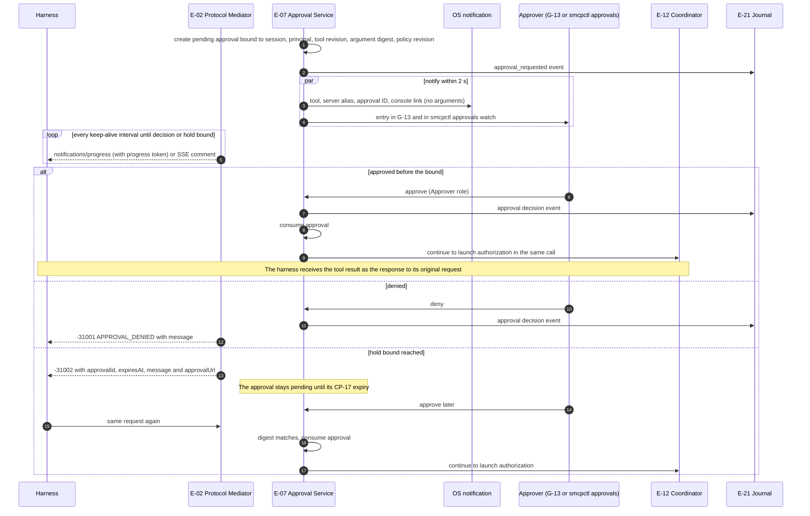

# Approval in hold mode

What happens when a call carries an approval obligation from policy, from an anomaly band or from session taint (FR-3.14 to FR-3.25, FR-1.51, SR-1.18-2, SR-5.13-2). CP-45 sets the hold bound (default 120 s) and keep-alive interval (default 10 s).

The `-31002` message tells the person in plain words to open the approval URL, approve, and run the same request again (Appendix B, Table B.2).

## Implementation

Implemented by `internal/approval` (E-07) with the edge changes in `internal/edge/stream.go`; see [../approvals.md](../approvals.md) and [../api/approvals.md](../api/approvals.md). Differences from the diagram:

- The console's Approvals view (G-13) belongs to E-24; it reads `/api/v1/approvals` and the watch stream this service provides.
- The keep-alive is sent once when the call is held and then every interval. A `tools/call` is answered as an event stream only once it is held; other calls stay JSON.
- Anomaly-band obligations (off by default, `require_approval_band`) and session-taint obligations (`TAINT_APPROVAL`) reach the service like policy-rule approvals, and an anomaly-band approval carries the band, the contributing feature, its z-score, the baseline snapshot and the context, which G-13 shows (FR-3.18).
- The real-harness run of FR-3.25 is recorded in [../verification/FR-3.25.md](../verification/FR-3.25.md).
