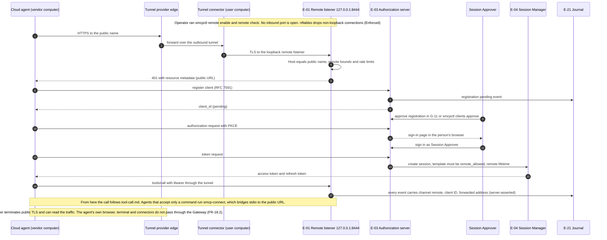

# Cloud agent through a tunnel

How an agent that runs on a vendor's computer (Grok Bot, ChatGPT "dots", Meta Muse) reaches a Gateway that stays on the user's computer (FR-16, SR-2.9-3, SR-2.11-2, SR-4.14-1, SR-4.14-2; ARCH §18.9).

## Implementation

Implemented in `internal/remote` (listener, OAuth, registration, limits), `internal/channel` (remote origin on evidence), `internal/tunnel` and `cmd/smcpctl/remote.go` (tunnels), and `internal/adapter` plus `packaging/npm/smcp-connect` (`smcp-connect`). Differences from the diagram:

- Templates allowed for remote sessions are those the Framework Profile marks `remote_allowed`, narrowed by `remote.templates` in the configuration.
- `smcp-connect` signs in with the device authorization grant (`/oauth/device_authorization`, `/oauth/device`) instead of the authorization-code redirect, because it usually runs on a computer without the person's browser.
- In the Enforced profile, `smcpctl remote enable` installs the nftables table `inet smcp_remote` (SR-4.14-1), which drops non-loopback connections to the Gateway ports; macOS has no equivalent installed automatically.

Approval events of held remote calls carry the remote origin fields (channel, client ID, client address) like the call events.

See `docs/remote-access.md`.
