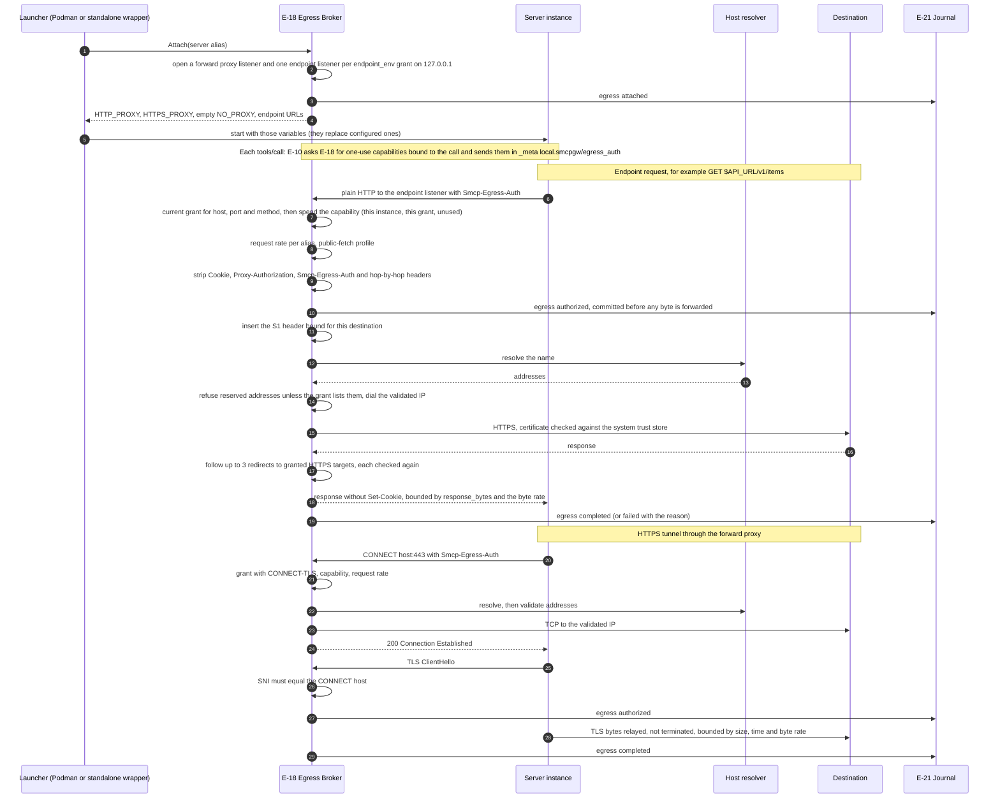

# Egress through the broker

How a server instance reaches a network destination through the Egress Broker: attachment at launch, then one brokered operation through a TLS-originating endpoint and one HTTPS tunnel through the forward proxy (E-18; FR-5.36 to FR-5.40, FR-6.6, SR-5.17-1; ARCH §18.6). Grants, limits and every reason code are in the [Egress Broker guide](../egress.md).

## Implementation

`internal/egress` (`proxy.go`, `dial.go`, `inject.go`, `launcher.go`, `nft_linux.go`), built by `egress.FromConfig` in `app.Start` when `[egress] enabled = true`. A refused operation answers with the reason code in `Smcp-Egress-Reason` and records an `egress` event with phase `denied`. Differences from the specification:

- In the enforced profile the rootless Podman launcher attaches a server with `network = "egress"` and installs the nftables table `inet smcp_egress` in the container's network namespace (slirp4netns with host loopback) before the server starts; the instance reaches the broker at `10.0.2.2`. `TestIntegrationEgressBroker` and the linux-integration job check on real Podman that direct connections are refused and a proxied request succeeds. The standalone wrapper attaches unconfined subprocesses.
- In the standalone profile the proxy variables are advisory: a server that ignores them reaches the network directly.
- Grants come from `[[egress.grant]]` in the configuration, not from policy decision obligations; endpoint variable names come from `endpoint_env`, not from signed manifests.
- One-use capabilities (SR-5.16-1) are minted by the broker when the Tool Dispatcher sends a call (`pipeline.EgressIssuer`) and revoked when the call returns; with `[egress] require_capability = false` they are neither minted nor required.
- A registered secret in the URL, a header or the body of a brokered HTTP request is refused with `EGRESS_SECRET_DETECTED` (SR-5.8-2); the bytes of a CONNECT tunnel are not scanned.
