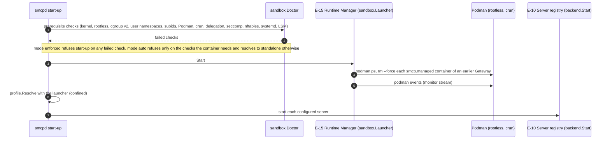
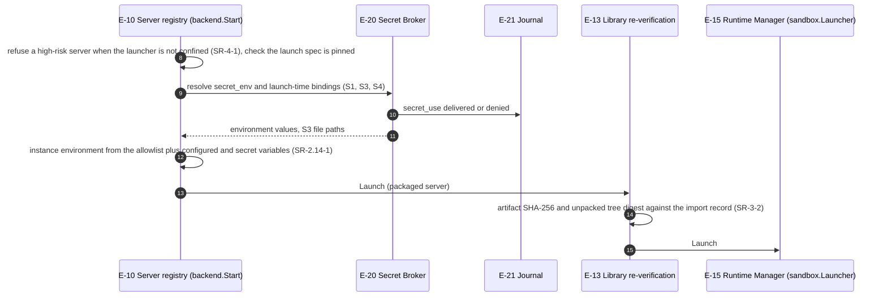
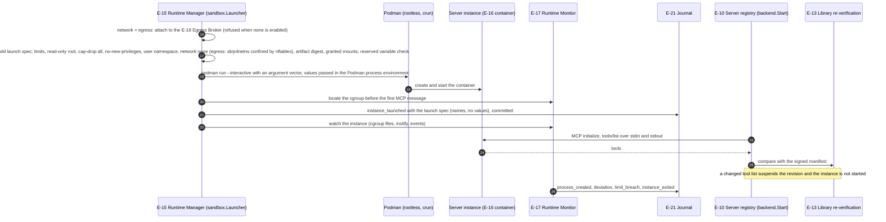

# Enforced sandbox launch

How `smcpd` starts one backend server in a rootless Podman container when `[runtime] sandbox = "podman"` (FR-5.27, FR-13.9, SR-3-2, SR-4-1, SR-4.5-1 to SR-4.7-2, SR-2.14-1; ARCH §18.1). The operator procedure and every option are in the [server sandbox guide](../sandbox.md).

The flow is drawn in three parts. Step numbers run on from one part to the next.

## 1. Start-up (steps 1–7)

## 2. Secrets and artifact check (steps 8–15, for each server)

## 3. Container launch and tool check (steps 16–26)

## Implementation

`internal/sandbox` (`FromConfig`, `Launcher`, `Build`, `PodmanArgs`, `Monitor`), wired in `cmd/smcpd/main.go`. The launcher chain from outside in is the library's verifying launcher (`internal/library/runtime.go`), the Secret Broker's wrapper (`internal/secrets/launcher.go`, which withdraws an instance's deliveries when it closes or fails to start) and `sandbox.Launcher`. The Egress Broker hands its attacher to the sandbox launcher (`SetEgress`) instead of wrapping it. Differences from the specification:

- A sandboxed server with `network = "egress"` is attached to the Egress Broker on slirp4netns and confined by nftables in its namespace before it starts ([sandbox.md](../sandbox.md#egress)); with `network = "none"` it has loopback only.
- Instances are shared across sessions; per-session and per-call scopes (FR-5.10) and idle teardown (FR-5.11) are deferred from release 1.0 (SRS Appendix N). An instance that times out or exits is relaunched; a failed relaunch suspends the server.
- When the artifact check in step 14 fails, the revision is suspended, the server is skipped and the registry withdraws the launch-time secret deliveries of step 9 (`withdrawn`, reason `LAUNCH_FAILED`; security review SR-14).
- `packaging/linux` ships and loads the AppArmor profiles `smcpd` and `smcp-server`; the latter attaches by path to the executables of image-less servers, so servers run from an image are covered by the container profile only. No SELinux module ships. With `[runtime] run_as`, Podman runs as the CP-46 server identity `smcp-srv` ([enforced-profile.md](../enforced-profile.md)).
- `scripts/ci-integration.sh` runs a second instance with `[runtime] sandbox = "podman"` on the linux-integration CI job, where a probe server must fail to open network sockets; the Linux-only tests in `internal/sandbox/integration_linux_test.go` exercise the launcher against Podman. macOS never reaches this flow and always runs the standalone profile.
