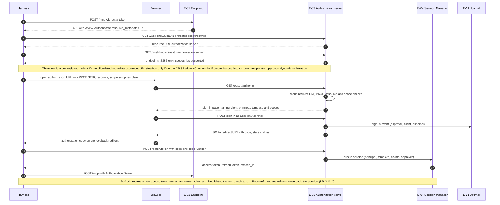

# OAuth sign-in

How a harness obtains a Gateway session through the Gateway's own OAuth 2.1 authorization server (FR-2.17 to FR-2.23, SR-2.11-1 to SR-2.11-5). The access token is the session (FR-2.20).

## Implementation

`internal/session/oauth.go` implements the flow, with `internal/authguard` for rate limits and lockout. Differences from the diagram:

- Only Session Approver accounts (`[[approver]]`) can complete the sign-in; the Administrator account is refused (FR-2.19, FR-2.23).
- A Client ID Metadata Document is fetched only for a URL on the CP-52 allowlist (`[[client_metadata]]`: 5 s, 64 KiB, same-host redirects, public addresses only, cached 24 h) and bound to its principal; other metadata URLs are refused without a fetch, and the metadata does not advertise `client_id_metadata_document_supported` (FR-2.18, SR-2.11-5).
- Sessions are in memory and end when the Gateway restarts (session survival across restarts, FR-2.16, is deferred from release 1.0).
- Dynamic Client Registration and the device grant exist only on the Remote Access listener (`internal/remote`, [../remote-access.md](../remote-access.md)).
