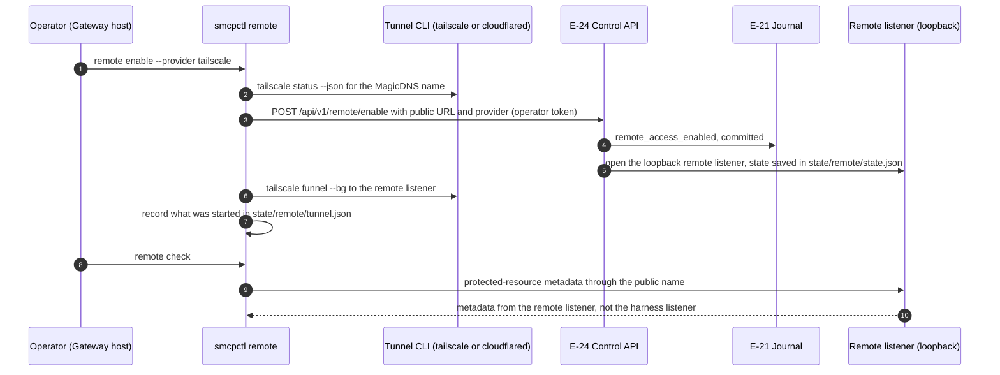
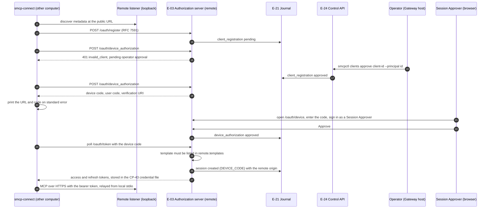
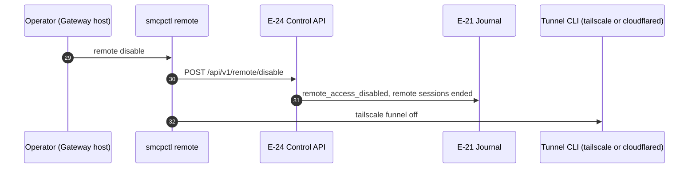

# Remote access: enable and device sign-in

How an operator opens the Remote Access Profile through a tunnel, and how `smcp-connect` on another computer registers, waits for approval and signs in with the device grant (FR-16.1 to FR-16.12, FR-12.13; ARCH §18.9). The browser-based authorization-code path of a cloud agent is the [cloud agent flow](cloud-agent-tunnel.md); configuration and limits are in the [Remote Access Profile guide](../remote-access.md).

The flow is drawn in three parts. Step numbers run on from one part to the next.

## 1. Enable and check (steps 1–10)

## 2. Client registration and device sign-in (steps 11–28)

## 3. Disable (steps 29–32)

## Implementation

`internal/remote` (listener, OAuth, registrations, `/api/v1/remote*`, `/api/v1/clients*`), `internal/tunnel` (Tailscale Funnel and Cloudflare quick tunnel drivers), `cmd/smcpctl/remote.go` and `internal/adapter/connect.go`. The console view G-11 (Remote access) offers the same enable, disable, approve, deny and revoke actions. Differences from the specification:

- With Cloudflare the tunnel is started before the enable request, because the public URL is only known once `cloudflared` reports it; with Tailscale the Gateway side is enabled first and disabled again if Funnel fails.
- In the Enforced profile `remote enable` installs the nftables table `inet smcp_remote` (SR-4.14-1) before the remote listener exists and `remote disable` removes it; on macOS the pf anchor in `docs/remote-access.md` is loaded by hand. The listeners are loopback-only regardless (SR-2.9-3).
- A remote session's template must be marked `remote_allowed` in the Framework Profile and listed in `remote.templates` (FR-16.12).
- The caller address is what the tunnel connector reports; a connector that reports none makes the per-address limits global.
- Dated runs with the cloud agents themselves (FR-15.9) are not recorded.
