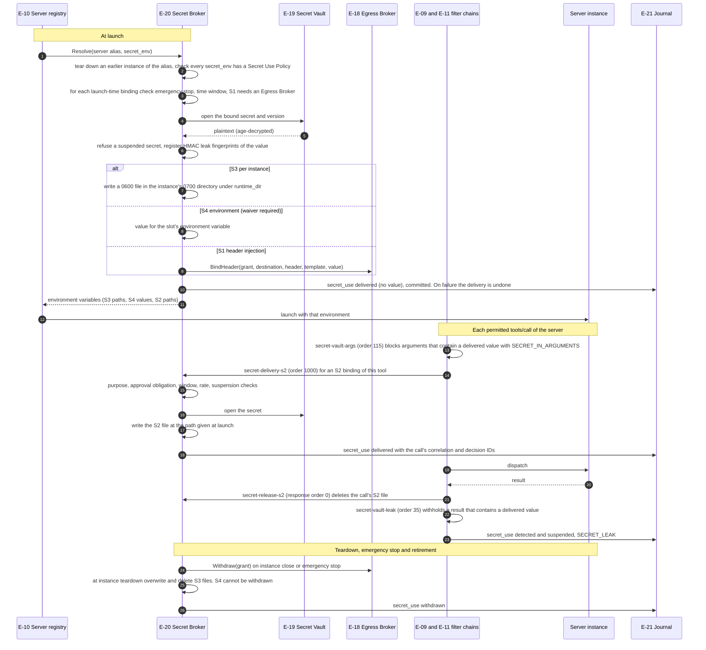

# Secret delivery

How the Secret Broker hands a vault secret to a server instance without the harness or the model seeing it: launch-time delivery (S1, S3, S4), per-call delivery (S2), and leak detection on every call (FR-6.4 to FR-6.12; ARCH §8). Configuration, the Secret Use Policy file and every reason code are in the [secrets guide](../secrets.md).

## Implementation

`internal/secrets` (`Broker.Resolve`, `deliverLaunch`, `filters.go`, `launcher.go`), enabled by a `[secrets]` table through `secrets.Configure` in `cmd/smcpd`. `app.Start` connects the broker to the Egress Broker as its `pipeline.SecretHeaderInjector` when `[egress] enabled = true`, and registers each delivered value with the E-09/E-11 inspector's fingerprint set. Differences from the specification:

- Secret Use Policies are read from their own file, not from the signed policy document, and slots are declared in that file until signed manifests declare them.
- The S2 file is written at request inspection, which runs before an approval hold, so it exists while a held call waits. It is deleted when the call's context ends, whatever the outcome, with a safety timer as a backstop.
- S1 headers are inserted only on Egress Broker endpoint requests, never on forward-proxy tunnels; sandboxed servers with `network = "egress"` reach the endpoints through the broker as unconfined ones do.
- Launch-time deliveries are not withdrawn when a session ends, because instances are not session-scoped.
- Delivered values are scanned in arguments, results and brokered outbound HTTP requests (`EGRESS_SECRET_DETECTED`, SR-5.8-2); CONNECT tunnels are not scanned.
