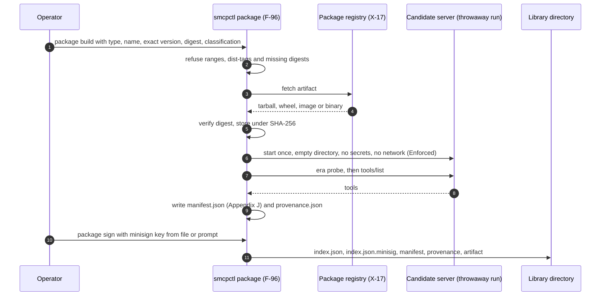
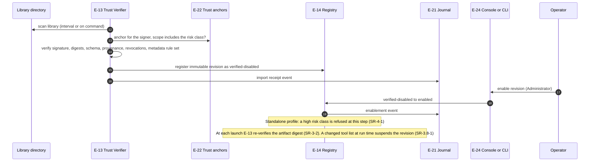

# Server packaging and admission

How an operator admits a local MCP server without an external curation system (FR-14, SR-3-1 to SR-3.10-1, SR-3.5-1, SR-5.9-2; ARCH §18.1). Packaging is the only step that contacts a package registry.

The flow is drawn in two parts. Step numbers run on from one part to the next.

## 1. Build and sign (steps 1–11)

## 2. Import and enable (steps 12–19)

## Implementation

Implemented in `internal/packaging` (formats, build, probe, minisign signing and verification, trust anchors) and `internal/library` (verifier, registry, run-time manifest source, control API routes); the operator procedure is the [packaging guide](../packaging-guide.md). Differences from the diagram:

- Only the directory library is scanned; there is no OCI registry library (FR-5.1).
- The probe runs with the host network in the Standalone profile; network removal needs a confining launcher (E-16).
- Enabling is done by `smcpctl package enable`, `POST /api/v1/packages/{id}/{revision}/enable` or **Enable** in the console view G-10 (Servers and library). A revision enabled while `smcpd` runs is launched at the next start.
- Instances are torn down by the backend registry (`Registry.Suspend`); there is no separate E-15 instance manager.
- `smcpctl bootstrap` packages the bundled `smcp-refserver`, signs it with a one-time key enrolled for the `low` class, and writes it as the example's only backend (FR-14.10).
