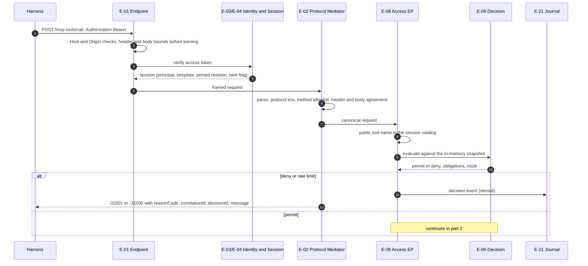
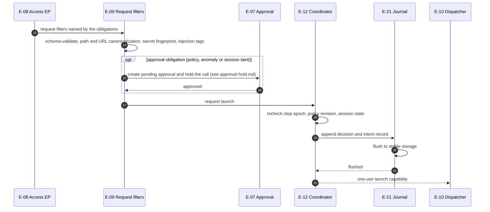
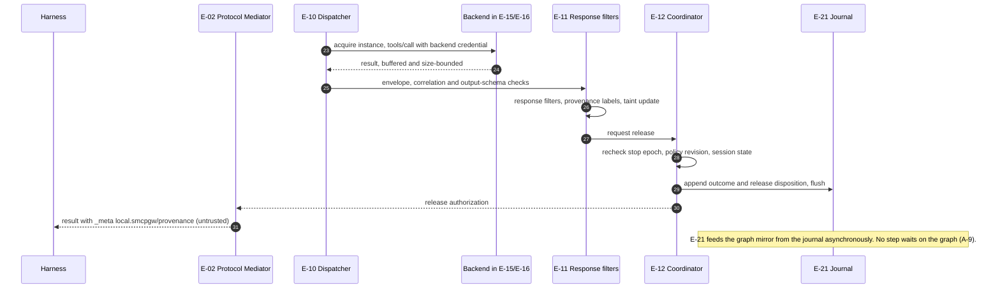

# Tool call

The path of one `tools/call` from a harness to a backend server and back, as specified in SRS V1.2 (FR-4.3 stage order) and ARCH §18.3. Element IDs are those of `ArchitectureV2.md`.

The path is drawn in three parts. Step numbers run on from one part to the next.

## 1. Authentication and decision (steps 1–12)

## 2. Request inspection, approval and launch authorization (steps 13–22, on permit)

## 3. Dispatch, response inspection and release (steps 23–31)

Every stage, from E-01 to E-11, emits timing spans and observables to E-29 asynchronously.

## Requirements on this path

| Step | Requirements |
|---|---|
| 2 | SR-2.9-1, SR-2.9-2, SR-7.11-1 |
| 3–4 | FR-2.5, SR-2.1-3, SR-2.11-1 |
| 6 | FR-1.10, FR-1.11, SR-5.2-1 |
| 8–10 | FR-1.30, SR-5.5-1, SR-1.3-1, FR-3.10 |
| 11–12 | FR-1.20, FR-1.51, SR-6.1-1 |
| 13–14 | FR-4.5, FR-4.16, FR-4.17, SR-1.8-1 |
| 15–16 | FR-3.14, FR-3.19, SR-5.13-2 |
| 17–22 | SR-1.17-1, SR-6.2-1, FR-4.13 |
| 23–24 | FR-4.8, FR-4.9, FR-4.10 |
| 25–26 | SR-5.20-1, SR-5.9-1, SR-5.13-1, SR-5.13-2 |
| 27–30 | SR-1.17-2, SR-6.3-1 |
| 31 | FR-4.12 |

## Implementation

`internal/edge/pipeline.go` follows the same order (authenticate, session check, fail-closed check, decision, request inspection, approval, launch authorization, dispatch, response inspection, provenance, release authorization). Differences:

- Request and response scoring (E-31) run as the last filters of the request and response chains; scoring is asynchronous by default, with optional synchronous approval and withhold obligations ([../observation.md](../observation.md)).
- A request filter that transforms the arguments causes a second decision before launch, and the launch is bound to it (SR-5.12-1).
- Progress notifications from backends are relayed with the northbound token after the response filters, at most 10 per second per request (CP-21), never after the response; the backend gets a Gateway-issued token.
- Backend instances are shared across sessions (no per-session or per-call scope).
- The graph mirror is fed asynchronously from the journal and is never consulted on the call path.
